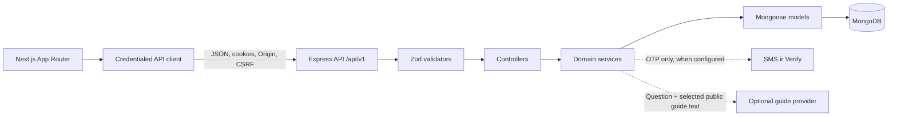

# System Architecture and Design

## Scope and status

Asoudeh is a Persian, right-to-left personal-finance web application. The browser UI is built with Next.js and React, the HTTP API with Express, and persistence with MongoDB through Mongoose. This document combines the architecture overview with implementation decisions. It describes the current code boundaries; it is not a production-readiness certification.

## Context and request flow

The frontend calls `frontend/lib/api/client.ts`, which centralizes credentialed requests, in-memory CSRF handling, session refresh/retry, and error presentation. Express applies security headers, CORS, JSON parsing, request logging, feature routers, not-found handling, and centralized error handling. Routes select middleware and endpoints; validators parse untrusted input; controllers adapt HTTP requests; services enforce ownership and business rules; models define persisted documents and indexes.

## Component boundaries

### Frontend

- `frontend/app/` contains the root document, public pages, authentication pages, and authenticated dashboard routes.
- `frontend/components/` contains shared navigation, brand, loading, public-page, and assistant UI.
- `frontend/lib/` contains API, authentication-flow, date, amount, and public-content helpers.
- Feature pages own presentation and interaction state. The API remains authoritative for identity and financial data.
- Browser storage is limited to non-secret UI or explicitly opted-in draft state. OTPs and access/refresh credentials are never stored there.

### Backend

- `backend/src/routes/` registers HTTP routes and middleware.
- `backend/src/validators/` parses request bodies and parameters with Zod.
- `backend/src/controllers/` translates HTTP requests and responses.
- `backend/src/services/` implements authentication, ownership, business rules, and aggregation.
- `backend/src/models/` defines MongoDB documents and indexes.

The registered API contract is in [API_Documentation.md](../02_API_and_Development/API_Documentation.md); persisted models and ownership rules are in [Database_Design.md](./Database_Design.md).

## Trust boundaries and security decisions

- Authentication is OTP-based. Access and refresh credentials are in HTTP-only cookies; the CSRF cookie is readable by the browser and its matching token is kept in memory.
- State-changing requests require the configured Origin and a matching CSRF cookie/header. Personal-data queries derive the owner from the authenticated identity, never from a caller-supplied owner ID.
- Refresh credentials are opaque random values stored as keyed hashes, rotated on refresh, and revocable by session family. Reuse of a rotated credential revokes its family.
- Caregiver access is a separate, accepted, permission-scoped read path. It grants no write access; revocation blocks subsequent reads.
- The optional assistant receives only the user's question and selected public guide content. Private profile and financial records are not sent by the application.

See [Security.md](../03_Operations_and_Security/Security.md) for security controls and remaining assurance limits.

## Domain and implementation decisions

### Identity and account lifecycle

- OTP challenges are single-use, expire after five minutes, and are protected by request limits, resend cooldown, failed-attempt tracking, and temporary blocking.
- The development simulator is a local-only no-SMS path and requires `NODE_ENV=development`; it does not return the code to the API client. It is not a fallback after provider failure.
- A confirmed account deletion immediately revokes access and schedules a 30-day delayed purge. A worker checks due accounts at startup and periodically. Purges are idempotent and remove related records before the user; cross-collection deletion is not a MongoDB transaction.

### Categories and transactions

- System categories (`userId: null`) are shared and read-only; personal categories and financial records are owner-scoped.
- New API categories use `income` or `expense`; legacy `both` values remain readable but are rejected on new writes.
- Amounts are positive integer toman values within the API limit. Transaction dates are date-only `YYYY-MM-DD` values, stored at UTC midnight; future transaction dates are rejected and current-day rules use `Asia/Tehran`.
- Transactions are listed newest-first with deterministic ID tie-breaking, default page size 20, and a maximum page size of 100. Deletion is soft deletion; the server enforces a ten-second restore window.
- Category physical deletion remains disabled with `409 CATEGORY_DELETION_UNAVAILABLE`. Safe reassignment needs concurrency-safe storage and a confirmed type-correct fallback.

### Budgets, dashboard, reports, and reminders

- Budgets use a Solar Hijri `MM-YYYY` key and a unique `(userId, categoryId, monthKey)` index. Spending includes only the owner's non-deleted expense transactions. Status thresholds are 80% and 100%; exact integer arithmetic is used for classification.
- Dashboard remaining is the profile's initial balance plus current Solar Hijri month income minus expenses; it is not a bank balance. Financial totals are serialized as integer strings where needed to preserve exactness.
- Monthly reports use the same Solar Hijri boundaries. Unavailable or cross-owner legacy category labels are replaced with a generic label rather than exposing another user's metadata.
- Reminder completion is stored separately and idempotently per Solar Hijri month. Monthly recurrence is recalculated from the original Jalali day and clamps to the month's last day when necessary. No SMS, email, push, or scheduled reminder delivery is implemented.
- Legacy yearly reminders and category type `both` remain readable; new writes accept only the currently supported values.

### Caregiver, accessibility, and offline behavior

- Caregiver invitations are bound to a verified phone and require explicit acceptance and one or more read permissions. Invitation delivery is out of band; no SMS notification is implemented.
- Font scale and high-contrast preferences belong to the authenticated profile. Automated checks do not establish WCAG conformance or real assistive-technology usability.
- The service worker caches only a generic offline page and its icon. It excludes authenticated pages, API responses, and financial data. Transaction drafts are opt-in, account-keyed, and session-only; this is not offline submission or synchronization.

## External services and operations

SMS.ir is called only by the backend Verify adapter when the development simulator is disabled. A successful provider response means acceptance, not handset delivery. The optional guide assistant is disabled unless its backend provider settings are valid. Production deployment, index rollout, live SMS delivery, backup/restore drills, and operational monitoring have not been verified. See [Environment_and_Services.md](../02_API_and_Development/Environment_and_Services.md) and [Deployment_and_Backup.md](../03_Operations_and_Security/Deployment_and_Backup.md).
