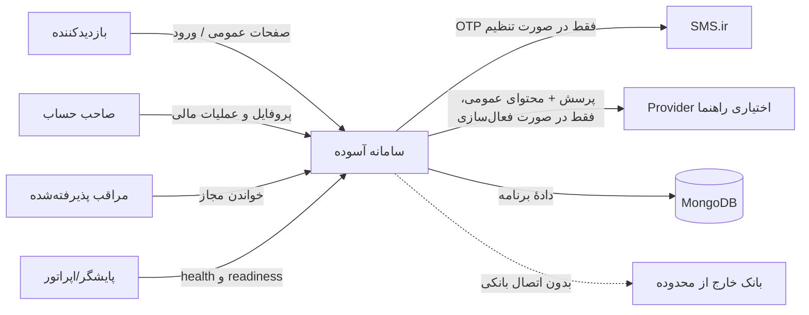
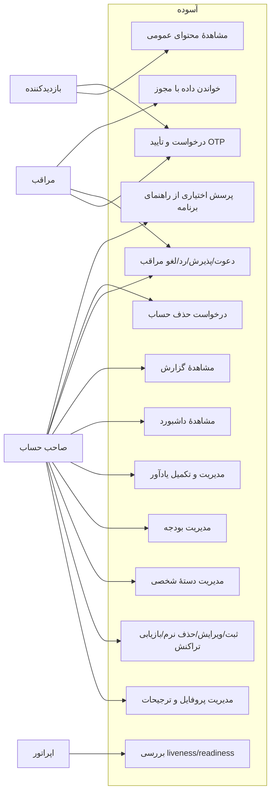
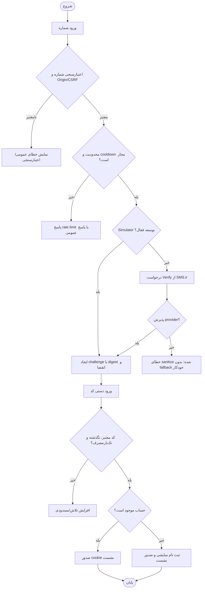
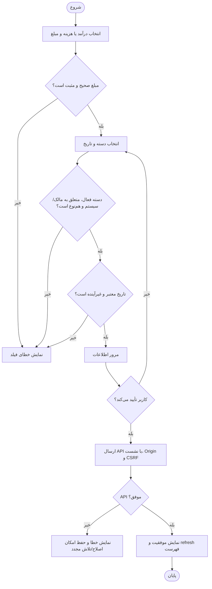
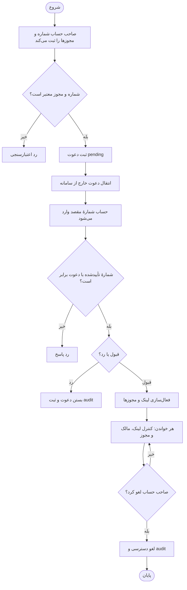
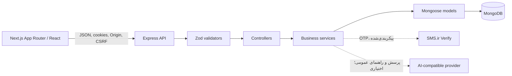

# گزارش تحلیل و مهندسی نیازمندی‌های سامانهٔ آسوده

> گزارش دانشگاهی/آرشیوی: تحلیل و وضعیت قابلیت‌ها snapshot تهیهٔ گزارش در ۱۵ نوامبر ۲۰۲۶ هستند؛ جدول شواهد آزمون در ۲۱ نوامبر ۲۰۲۶ به‌روزرسانی شده است. برای راه‌اندازی و وضعیت عملیاتی جاری از [README.md](../../README.md) و [Testing and Performance](./Testing_and_Performance.md) استفاده کنید.

## صفحهٔ عنوان

**دانشگاه:** [نیازمند تکمیل توسط دانشجو] 
**درس:** مهندسی نرم‌افزار ۲ 
**عنوان:** انتخاب، تحلیل و اعتبارسنجی نیازمندی‌های سامانهٔ مدیریت مالی شخصی آسوده 
**نام دانشجو:** [نیازمند تکمیل] 
**نام استاد:** [نیازمند تکمیل] 
**تاریخ گزارش:** ۱۵ نوامبر ۲۰۲۶

> این گزارش بر مبنای مخزن فعلی، مشخصات اولیهٔ پروژه و نتایج آزمون‌های قابل مشاهده تهیه شده است. این متن گواهی آمادگی تولید، آزمون امنیتی رسمی یا مطالعهٔ کاربری نیست.

## ۱. چکیده

آسوده یک سامانهٔ وب فارسی و راست‌به‌چپ برای ثبت و مرور درآمد و هزینه، مدیریت دسته‌بندی و بودجه، یادآوری سررسیدها و گزارش مالی است. مشخصات اولیه، سالمندان و کاربران کم‌تجربه در فناوری را مخاطب اصلی معرفی می‌کند و بر کاهش پیچیدگی، متن خوانا و دسترس‌پذیری تأکید دارد. سامانه همچنین امکان دعوت مراقب با دسترسی محدود، پذیرفته‌شده، فقط‌خواندنی و قابل لغو را فراهم می‌کند.

بررسی کد نشان می‌دهد هستهٔ مالی، API و صفحات اصلی پیاده‌سازی شده‌اند؛ با این حال ارسال زندهٔ OTP، استقرار عملیاتی، rollout ایندکس‌های تولید، backup/restore و سنجش تجربهٔ کاربران واقعی تأیید نشده‌اند. نسخهٔ کنونی حذف فیزیکی دسته‌بندی را عمداً مسدود کرده است. آزمون‌های مرورگر، API، واحد و ابزارهای کیفیت وجود دارند؛ اجرای محلی Playwright در این بازبینی ۷۲ موفق و ۱ مورد skip عمدی گزارش کرده است. این نتیجه معادل آزمون backend، WCAG conformance یا اعتبارسنجی با کاربران واقعی نیست.

این گزارش شناسه‌های FR-01 تا FR-19 را از مشخصات اولیه حفظ می‌کند. قابلیت‌های افزودهٔ موجود با ادامهٔ مستقل شناسه‌ها ثبت می‌شوند. شواهد کد، اهداف سند، نتایج اجرای آزمون و پیشنهاد تحلیلی در سراسر گزارش برچسب جدا دارند.

## ۲. مقدمه و روش بررسی

### ۲.۱ هدف

هدف، تحلیل یک سیستم واقعی برای تکلیف مهندسی نرم‌افزار ۲ است: تعریف مسئله و محدوده، تحلیل فرایندها، استخراج و اعتبارسنجی نیازمندی‌ها، ثبت شواهد معماری و آزمون، و پیشنهاد بهبودهای متناسب با ریسک‌های مشاهده‌شده.

### ۲.۲ روش و مرز ادعاها

- **[کد]**: قابلیت با روت، صفحه، سرویس، مدل، validator یا تست متناظر در checkout مشاهده شده است.
- **[سند]**: هدف، قاعده یا نتیجه در سند پروژه آمده؛ وجود آن به‌تنهایی پیاده‌سازی را اثبات نمی‌کند.
- **[اجرای آزمون]**: فرمان واقعاً اجرا شده و نتیجهٔ آن در همین محیط ثبت شده است.
- **[تحلیل]**: تفسیر یا معیار پیشنهادی این گزارش است و نباید به‌عنوان واقعیت اندازه‌گیری‌شده خوانده شود.
- **[نیازمند بررسی]**: شواهد موجود برای نتیجه‌گیری کافی نیست.

منابع اصلی عبارت‌اند از `docs/SPECIFICATION.docx`, `docs/SPECIFICATION.pdf`, `README.md`, `docs/02_API_and_Development/API_Documentation.md`, `docs/01_Architecture_and_Design/System_Architecture.md`, `docs/01_Architecture_and_Design/Database_Design.md`, `docs/03_Operations_and_Security/Security.md`, `docs/04_Academic_and_Quality/Testing_and_Performance.md` و کدهای `backend/src/` و `frontend/`. نسخهٔ DOCX برای خواندن متن فارسی استفاده شد؛ متن PDF نیز به‌صورت محلی استخراج و برای خلاصهٔ مشخصات در راهنمای roadmap بررسی شد.

## ۳. انتخاب سیستم و معرفی

### ۳.۱ سیستم انتخاب‌شده

**نام:** آسوده (Asoudeh) 
**نوع:** سامانهٔ وب مدیریت مالی شخصی 
**معماری اجرایی:** Next.js/React در مرورگر، API مبتنی بر Express و MongoDB از طریق Mongoose 
**زبان رابط:** فارسی و RTL 
**مخاطب طراحی در سند اولیه:** سالمندان و کاربران کم‌تجربه در استفاده از نرم‌افزار مالی.

### ۳.۲ مسئلهٔ مورد هدف

**[سند]** مشخصات اولیه مسئله را دشواری استفاده از ابزارهای مالی دیجیتال برای افراد کم‌تجربه یا سالمند توصیف می‌کند: متن یا کنترل کوچک، گزینه‌های زیاد، مراحل پیچیده و خطاهای نامفهوم. مسئلهٔ کسب‌وکار آسوده، ثبت و مرور سادهٔ داده‌های مالی روزمره است؛ نه نگهداری پول، انتقال وجه یا جایگزینی بانک.

**[تحلیل]** دشواری تجربهٔ کاربران، فرضیهٔ محصول در سند است؛ از مخزن به‌تنهایی نمی‌توان شیوع این مسئله یا موفقیت طراحی را در جمعیت واقعی نتیجه گرفت. مصاحبه و آزمون کاربری گزارش‌شده‌ای برای تأیید آن در checkout وجود ندارد.

**هدف سنجش‌نشده:** مشخصات اولیه نرخ موفقیت وظایف را «تا حد امکان ≥۹۵٪» هدف می‌گیرد. این مقدار صرفاً هدف مستند است؛ در این گزارش مطالعهٔ کاربری یا نرخ موفقیت واقعی اندازه‌گیری نشده است و هر معیار نهایی باید با مالک محصول تأیید شود.

### ۳.۳ چالش‌های مهندسی مشاهده‌شده

| چالش | شاهد فعلی | پیامد تحلیلی |
| --- | --- | --- |
| هویت و نشست بدون گذرواژه | OTP، cookie، CSRF، Origin، refresh rotation و idle expiry در `backend/src/services/auth.service.ts` و middlewareها | وابستگی ورود عملیاتی به کانال SMS و پیکربندی امن cookie/origin. |
| صحت مبالغ و مالکیت | مبالغ صحیح تومان، queryهای owner-scoped و aggregation در سرویس‌های مالی | نشت یا محاسبهٔ اشتباه مانده می‌تواند به اعتماد کاربر لطمه بزند؛ مالکیت باید در هر API حفظ شود. |
| تقویم شمسی و زمان | ماه مالی شمسی، منطقهٔ `Asia/Tehran` و موعد یادآور ماهانه | تبدیل مرز ماه/روز و ماه کوتاه به آزمون‌های مشخص نیاز دارد. |
| دسترسی مراقب | دعوت، پذیرش و سه مجوز خواندن با audit | کنترل هر درخواست و لغو فوری لازم است؛ مراقب نباید با owner یکی فرض شود. |
| حذف دسته با سابقه | `DELETE /categories/:id` عمداً `409 CATEGORY_DELETION_UNAVAILABLE` می‌دهد | حذف و reassignment چندسندی در MongoDB standalone می‌تواند race و مرجع یتیم بسازد؛ انسداد فعلی تصمیم ایمنی است. |
| حذف حساب چندمجموعه‌ای | purge قابل retry و idempotent است، اما تراکنش چندمجموعه‌ای ندارد | شکست جزئی، شاخص‌ها، مشاهده‌پذیری worker و backup/restore نیازمند کنترل عملیاتی‌اند. |
| وابستگی خارجی | SMS.ir و provider دستیار اختیاری‌اند | پاسخ پذیرفته‌شدهٔ provider معادل تحویل پیام نیست؛ شرایط حفظ دادهٔ provider دستیار نیز باید بررسی شود. |

## ۴. وضعیت موجود و قابلیت‌ها

### ۴.۱ صفحات و نقاط ورود

| صفحه/مسیر | رفتار واقعی قابل مشاهده | وضعیت |
| --- | --- | --- |
| `/` | صفحهٔ عمومی معرفی و لینک ورود/راهنما | صفحهٔ ایستا پیاده‌سازی شده. |
| `/about`, `/contact`, `/faq`, `/guide`, `/privacy`, `/terms` | محتوای اطلاع‌رسانی عمومی | صفحات موجود؛ صفحهٔ تماس، در کد بررسی‌شده، فرم ارسال پیام نیست. |
| `/login`, `/verify-otp` | درخواست کد، ورود دستی OTP و تکمیل نام برای حساب جدید | جریان UI/API موجود؛ ارسال زندهٔ SMS تأیید نشده. |
| `/welcome` | راهنمای سه‌مرحله‌ای، موجودی آغازین اختیاری و هدایت به ثبت تراکنش یا داشبورد | پیاده‌سازی شده. |
| `/dashboard` | جمع‌های ماه جاری، مانده، تراکنش‌های اخیر و سررسیدها | پیاده‌سازی و آزمون API مستند است. |
| `/transactions`, `/transactions/new` | فهرست، فرم سه‌مرحله‌ای؛ مسیر `new` هدایت به جریان اصلی | پیاده‌سازی شده؛ حذف نرم و undo ده‌ثانیه‌ای. |
| `/categories` | دسته‌های سیستمی/شخصی، ساخت، ویرایش و فعال‌سازی | حذف فیزیکی غیرفعال است. |
| `/budgets`, `/reminders`, `/reports` | بودجهٔ ماهانه، یادآور و گزارش ماه شمسی | هسته پیاده‌سازی شده؛ اعلان خارجی یادآور وجود ندارد. |
| `/settings` | پروفایل، ترجیحات دسترس‌پذیری، پوسته، خروج و درخواست حذف حساب | پیاده‌سازی شده؛ حذف حساب به OTP و purge زمان‌بندی‌شده وابسته است. |
| `/caregiver`, `/caregiver/[seniorId]` | دعوت/پذیرش/رد/لغو و مشاهدهٔ دادهٔ مجاز | خواندن مجوزمحور؛ تحویل دعوت بیرون از سامانه است. |

### ۴.۲ نقش‌ها و ذی‌نفعان

| ذی‌نفع/نقش | اختیار در سامانه | مرز دسترسی |
| --- | --- | --- |
| بازدیدکننده | مشاهدهٔ صفحات عمومی و آغاز ورود | به دادهٔ مالی دسترسی ندارد. |
| صاحب حساب | مدیریت پروفایل و دادهٔ مالی خود، دعوت و لغو مراقب | شناسهٔ مالک از نشست گرفته می‌شود، نه از body درخواست. |
| مراقب | مشاهدهٔ خلاصه، تراکنش و/یا گزارش مطابق grant پذیرفته‌شده | هیچ API نوشتنی برای دادهٔ صاحب حساب ندارد. |
| اپراتور محلی/عملیاتی | بررسی health/readiness و اجرای فرمان‌های محدود نگهداری | نقش اپراتوری محصول یا پنل مدیریت در UI/API بررسی‌شده مشاهده نشد. |
| مدیر | مدل `User.role` مقدار `admin` را می‌پذیرد | **[نیازمند بررسی]** روت یا workflow مدیریتی و middleware مجوزدهی ادمین شناسایی نشد؛ این فیلد به‌تنهایی قابلیت مدیر را اثبات نمی‌کند. |

## ۵. محدوده و خارج از محدوده

### ۵.۱ در محدودهٔ واقعی نسخهٔ بررسی‌شده

ثبت درآمد و هزینه، دسته‌بندی، فهرست و ویرایش تراکنش، soft-delete/undo، داشبورد، بودجه، یادآور ماهانه، گزارش ماهانه، پروفایل و ترجیحات، مراقب خواندنی، احراز هویت OTP، پوستهٔ PWA عمومی و راهنمای اختیاری.

### ۵.۲ خارج از محدوده یا پیاده‌سازی‌نشده

| قابلیت | وضعیت مستند و کد |
| --- | --- |
| اتصال بانکی، انتقال پول، پرداخت و تطبیق خودکار | در محدودهٔ API جاری مشاهده نشد؛ در مشخصات خارج از MVP است. |
| ارسال واقعی SMS و اثبات تحویل | adapter سروری هست؛ اعتبارنامه/قالب و تحویل زنده تأیید نشده‌اند. simulator فقط توسعه‌ای است. |
| اعلان خارجی برای یادآور یا دعوت مراقب | پیاده‌سازی نشده؛ وضعیت‌ها فقط در برنامه نمایش داده می‌شوند. |
| OCR و ورود صوتی تراکنش | در مشخصات فاز بعد/خارج از MVP؛ پیاده‌سازی مشاهده نشد. خواندن متن صفحه با voice input تفاوت دارد. |
| ثبت تراکنش آفلاین و همگام‌سازی | وجود ندارد؛ service worker دادهٔ مالی یا API را cache نمی‌کند. |
| حذف فیزیکی دسته با انتقال تراکنش | endpoint عمداً غیرفعال و پاسخ `409` است. |
| backup/restore، پایش تولید، SLA و deployment تأییدشده | در مخزن دستورالعمل/پایه‌هایی وجود دارد؛ اجرای عملیاتی اثبات نشده است. |
| مطالعهٔ آماری کاربری و ادعای نرخ موفقیت | نتیجهٔ کاربران واقعی در مخزن ثبت نشده است. |

## ۶. فرایندهای سیستم

### ۶.۱ ثبت‌نام و ورود

1. کاربر شمارهٔ همراه را وارد و OTP درخواست می‌کند.
2. backend شماره را نرمال می‌کند، rate limit/cooldown را اعمال و از simulator توسعه یا SMS.ir پیکربندی‌شده استفاده می‌کند.
3. کاربر کد را دستی در `/verify-otp` وارد می‌کند؛ کد در API response یا browser storage نگهداری نمی‌شود.
4. کاربر موجود: OTP مصرف و نشست cookie صادر می‌شود. کاربر جدید: ثبت‌نام کوتاه‌عمر و نام نمایشی لازم است.
5. frontend درخواست‌های state-changing را با Origin و CSRF می‌فرستد؛ refresh، logout و idle expiry سمت سرور کنترل می‌شوند.

**محدودیت:** جریان محلی simulator با SMS زنده یکسان نیست؛ Live SMS اجرا نشده است.

### ۶.۲ ثبت درآمد/هزینه و مدیریت تراکنش

1. کاربر نوع و مبلغ را تعیین می‌کند.
2. دستهٔ متناسب و فعال، تاریخ و توضیح اختیاری را انتخاب می‌کند.
3. صفحه مرور، مقادیر را نشان می‌دهد و کاربر تأیید می‌کند.
4. API مالک را از نشست می‌گیرد و مبلغ/تاریخ/دسته را اعتبارسنجی می‌کند.
5. فهرست، صفحه‌بندی و جمع‌های وابسته از دادهٔ معتبر refresh می‌شوند.
6. حذف نرم با پنجرهٔ تأیید و مهلت undo ده‌ثانیه‌ای انجام می‌شود.

### ۶.۳ دسته‌بندی

کاربر دستهٔ شخصی را می‌سازد یا ویرایش/فعال/غیرفعال می‌کند. دستهٔ سیستم فقط خواندنی است. seed یازده دسته با فرمان محدود توسعه‌ای انجام می‌شود و API فهرست خودکار seed نمی‌کند. حذف فیزیکی دستهٔ شخصی موجود در وضعیت فعلی، چه دارای تراکنش باشد و چه نباشد، رد می‌شود.

### ۶.۴ بودجه و یادآور

بودجه برای یک دستهٔ هزینه در یک ماه شمسی ثبت می‌شود. مصرف از هزینه‌های حذف‌نشدهٔ همان مالک محاسبه و با مرزهای دقیق ۸۰٪ و ۱۰۰٪ طبقه‌بندی می‌شود. یادآور می‌تواند بدون تکرار یا ماهانه باشد؛ تکمیل ماهانه به ماه شمسی وابسته است و تاریخ روزهای غیرموجود clamp می‌شود. هیچ job ارسال SMS/email/push برای یادآور وجود ندارد.

### ۶.۵ گزارش و داشبورد

داشبورد جمع درآمد/هزینه و ماندهٔ ماه شمسی، پنج تراکنش اخیر و حداکثر پنج سررسید هفت‌روزه را می‌دهد. گزارش ماهانه جمع، تعداد، سهم دسته و مقایسه با ماه قبل را برمی‌گرداند. queryها باید فقط دادهٔ مالک و تراکنش‌های حذف‌نشده را وارد کنند.

### ۶.۶ دعوت و مدیریت مراقب

1. صاحب حساب شمارهٔ مراقب و یک یا چند مجوز خواندن را انتخاب می‌کند.
2. دعوت در حالت pending می‌ماند؛ پیام دعوت باید بیرون از آسوده منتقل شود.
3. حساب ثبت‌شده با شمارهٔ تأییدشدهٔ مطابق، دعوت را می‌پذیرد یا رد می‌کند.
4. هر endpoint خواندن، لینک active و مجوز مرتبط را کنترل می‌کند.
5. لغو صاحب حساب، دسترسی درخواست بعدی را می‌بندد؛ رویدادهای اصلی audit می‌شوند.

### ۶.۷ پروفایل و ترجیحات

صاحب حساب نام، سال تولد اختیاری و موجودی آغازین را در `/me/profile` ویرایش می‌کند. اندازهٔ قلم در چهار مقدار مجاز و کنتراست بالا در ترجیحات حساب نگهداری می‌شود. تنظیمات theme مرورگر از این ترجیحات متمایز است.

## ۷. نمودارهای سیستم

### ۷.۱ Context Diagram

خط‌چین بانک به معنی ارتباط نیست؛ بانک صرفاً مرز خارج از محدوده را نشان می‌دهد.

### ۷.۲ Use Case Diagram

### ۷.۳ Activity Diagram: OTP

### ۷.۴ Activity Diagram: ثبت تراکنش

### ۷.۵ Activity Diagram: دعوت مراقب

### ۷.۶ معماری سطح بالا

## ۸. نیازمندی‌های عملکردی

### ۸.۱ قرارداد شناسه‌ها و اولویت

**شناسهٔ مرجع:** FR-01 تا FR-19 مطابق جدول فصل ۵ مشخصات اولیه؛ FR-04 پروفایل، FR-05 هزینه و FR-06 درآمد. شناسه‌ها ثابت‌اند و در این گزارش تغییر نکرده‌اند. [راهنمای آزمون و ردیابی](./Testing_and_Performance.md) توسعه‌های FR-20 (مالکیت/جداسازی داده) و FR-21 (خطای قابل فهم و بازیابی) را ثبت می‌کند. قابلیت‌های افزودهٔ دیگر این گزارش از FR-22 ادامه می‌یابند. BR-08 یک قانون کسب‌وکار حذف حساب است، نه جایگزین FR.

**MoSCoW:** M=ضروری، S=مهم، C=در صورت ظرفیت. اولویت FR-01..FR-19 از سند اولیه است؛ اولویت FR-20 به بعد تحلیل همین گزارش است و باید با ذی‌نفعان تأیید شود.

### ۸.۲ کاتالوگ نیازمندی‌ها

| ID و عنوان | نقش، اولویت و وضعیت | ورودی و پیش‌شرط | خروجی و پس‌شرط | معیار پذیرش قابل آزمون؛ پیاده‌سازی/تست |
| --- | --- | --- | --- | --- |
| **FR-01 ورود/ثبت‌نام با شماره و OTP** | بازدیدکننده؛ M؛ پیاده‌سازی‌شده، SMS زنده تأییدنشده | شمارهٔ همراه نرمال‌پذیر؛ Origin و CSRF معتبر | challenge یا مرحلهٔ تکمیل ثبت‌نام؛ در حساب موجود cookie نشست | Given شمارهٔ معتبر و simulator توسعه یا provider آماده؛ When کاربر درخواست کد می‌دهد؛ Then پاسخ، کد را افشا نمی‌کند و cooldown/rate limit اعمال می‌شود. `POST /auth/otp/request`, `/auth/otp/verify`, `/auth/register/complete`; `backend/src/services/auth.service.ts`; `backend/src/tests/auth.api.test.ts`, `frontend/tests/auth.spec.ts`. |
| **FR-02 انقضا و محدودیت OTP** | بازدیدکننده؛ M؛ کد پیاده‌سازی شده، provider جداگانه blocked | کد شش‌رقمی، challenge معتبر | نشست یا خطای عمومی؛ challenge پس از مصرف قابل replay نیست | کد پس از ۵ دقیقه رد؛ پنجمین تلاش ناموفق منجر به block ده‌دقیقه‌ای؛ تلاش‌های rate-limit شده رد شوند. `OtpChallenge.ts`, `OtpRateLimit.ts`; `auth.unit.test.ts`, `auth.api.test.ts`. |
| **FR-03 نشست و خروج** | صاحب حساب؛ M؛ پیاده‌سازی‌شده، رفتار چندتب نیازمند بررسی | access/refresh cookie، CSRF؛ نشست فعال | refresh چرخانده، logout revoke، idle expiry | refresh token قبلی پس از rotation رد و خانواده revoke؛ activity فقط با تعامل معتبر idle deadline را تمدید کند؛ پس از ۱۰ دقیقه بی‌کاری API محافظت‌شده رد شود. `/auth/refresh`, `/auth/activity`, `/auth/logout`; `AuthSession.ts`, `middleware/auth.ts`; آزمون auth backend و `frontend/tests/auth.spec.ts`. |
| **FR-04 مدیریت پروفایل** | صاحب حساب؛ M؛ پیاده‌سازی‌شده | نام، سال تولد اختیاری، موجودی آغازین؛ نشست/CSRF معتبر | پروفایل ذخیره و بازگردانده شود | Given profile موجود؛ When فیلد معتبر ویرایش شود؛ Then مقدار جدید در GET بعدی برگردد؛ مقادیر خارج از دامنه رد شوند. `GET /me`, `PATCH /me/profile`; `auth.validator.ts`, `frontend/app/(dashboard)/settings/page.tsx`; auth API و settings E2E. |
| **FR-05 ثبت هزینه** | صاحب حساب؛ M؛ پیاده‌سازی‌شده | مبلغ عدد صحیح مثبت، دستهٔ هزینه، تاریخ پیش‌فرض امروز یا انتخابی، توضیح اختیاری تا ۲۰۰ نویسه؛ نشست فعال | هزینه ذخیره، در فهرست/جمع‌ها دیده شود | مبلغ منفی/کسری/بیش از حد، دستهٔ نامعتبر و تاریخ آینده رد؛ پس از submit موفق پاسخ و فهرست باید هزینه را نشان دهد. `POST /transactions`; `transaction.validator.ts`, `transactions.service.ts`, صفحهٔ تراکنش؛ `transactions.api.test.ts`, `frontend/tests/transactions.spec.ts`. |
| **FR-06 ثبت درآمد** | صاحب حساب؛ M؛ پیاده‌سازی‌شده | همان فیلدهای FR-05 با نوع و دستهٔ درآمد | درآمد ذخیره و جمع درآمد به‌روز شود | Given دستهٔ درآمد فعال؛ When مبلغ معتبر ثبت شود؛ Then نوع `income` در API ذخیره و در پاسخ/داشبورد منعکس شود؛ دستهٔ هزینه رد شود. همان endpoint و فایل‌های FR-05؛ تست‌های API و `transactions.spec.ts`. |
| **FR-07 فهرست تراکنش‌ها** | صاحب حساب؛ M؛ پیاده‌سازی‌شده | صفحه و اندازهٔ صفحه؛ نشست فعال | تراکنش‌های مالک، جدیدترین اول و pagination | پیش‌فرض ۲۰ مورد؛ حذف‌شده و دادهٔ سایر مالک‌ها نمایش داده نشوند؛ totalPages و page با داده سازگار باشند. `GET /transactions`; `transactions.service.ts`; `transactions.api.test.ts`, `frontend/tests/transactions.spec.ts`. |
| **FR-08 فیلتر تراکنش‌ها** | صاحب حساب؛ S؛ API کامل‌تر از حداقل سند، ترکیب‌های UI/test محدود | نوع، دسته، بازهٔ تاریخ/ماه و در توسعهٔ جاری متن جست‌وجو/مرتب‌سازی | صفحهٔ فیلترشده با شمارنده | هر فیلتر به‌تنهایی نتایج خارج از شرط را حذف کند؛ تاریخ دو سر بازه inclusive باشد؛ جست‌وجو literal باشد. `GET /transactions?type&categoryId&from&to&search&sortBy&sortOrder`; transaction validator/service/UI؛ API query tests و `transactions.spec.ts`. |
| **FR-09 ویرایش تراکنش** | صاحب حساب؛ M؛ پیاده‌سازی‌شده | شناسه و یک یا چند فیلد معتبر | رکورد همان مالک اصلاح شود و جمع‌ها از دادهٔ جدید محاسبه شوند | تغییرات معتبر ذخیره؛ شناسهٔ نامعتبر 400 و رکورد غایب/غیرمالک 404؛ category غیر‌فعال فعلی فقط طبق قاعدهٔ نگهداری رکورد قابل حفظ است. `PATCH /transactions/:id`; `transactions.service.ts`; API و E2E transaction tests. |
| **FR-10 حذف و بازگردانی تراکنش** | صاحب حساب؛ M؛ پیاده‌سازی‌شده | شناسه؛ تأیید UI؛ نشست و CSRF | soft-delete و مهلت undo ده‌ثانیه‌ای | پس از حذف از فهرست عادی حذف شود؛ undo در ≤۱۰s موفق و بعد از آن `410`؛ مالک دیگر دسترسی نگیرد. `DELETE /transactions/:id`, `POST /transactions/:id/restore`; API و `transactions.spec.ts`. |
| **FR-11 دسته‌بندی** | صاحب حساب؛ M/S؛ مدیریت پایه کامل، حذف فیزیکی مسدود | نام یکتا، نوع درآمد/هزینه، نماد؛ دستهٔ شخصی | دستهٔ شخصی ایجاد/ویرایش/فعال یا غیرفعال؛ دسته‌های سیستم فهرست شوند | نام ۱..۵۰ نویسه و یکتا برحسب owner/type؛ system category تغییرناپذیر؛ DELETE برای هر دستهٔ شخصی موجود 409 می‌دهد و داده را بدون تغییر می‌گذارد. `/categories`; `categories.service.ts`, `Category.ts`, seed script؛ `categories.api.test.ts`, `frontend/tests/categories.spec.ts`. |
| **FR-12 بودجهٔ ماهانه** | صاحب حساب؛ S؛ پیاده‌سازی‌شده | دستهٔ هزینهٔ شخصی فعال، ماه شمسی، سقف مثبت | مصرف، باقی‌مانده و وضعیت | ترکیب owner/category/month یکتا؛ <۸۰ normal، ۸۰ تا <۱۰۰ warning، ≥۱۰۰ exceeded با محاسبهٔ دقیق؛ حذف تراکنش در مصرف حساب نشود. `/budgets`; `budgets.service.ts`, `Budget.ts`; `budgets.api.test.ts`, `frontend/tests/budgets.spec.ts`. |
| **FR-13 یادآوری** | صاحب حساب؛ M؛ مدیریت درون‌برنامه‌ای پیاده‌سازی‌شده، تحویل اعلان وجود ندارد | عنوان، تاریخ، مبلغ اختیاری، recurrence none/monthly | یادآور فعال/بایگانی یا completion ماهانه | موعدهای امروز تا ۷ روز بعد در داشبورد؛ completion ماهانه در همان ماه idempotent؛ ماه کوتاه clamp؛ SMS/email/push از این معیار مستثنا و پیاده‌سازی‌نشده. `/reminders`; `reminders.service.ts`; `reminders.api.test.ts`, `reminderCalendar.unit.test.ts`, `frontend/tests/reminders.spec.ts`. |
| **FR-14 داشبورد** | صاحب حساب؛ M؛ پیاده‌سازی‌شده | نشست و ماه جاری شمسی | مانده، درآمد/هزینهٔ ماه، حداکثر پنج تراکنش و پنج سررسید | مانده = موجودی آغازین + درآمد ماه − هزینه ماه؛ حذف‌شده‌ها کنار گذاشته شوند؛ حالت دادهٔ خالی صفر/آرایهٔ خالی برگرداند. `GET /dashboard`; `dashboard.service.ts`; `dashboard.api.test.ts`; UI توسط shell/responsive flows پوشش محدود دارد. |
| **FR-15 گزارش ساده** | صاحب حساب؛ S؛ API/UI پیاده‌سازی‌شده | ماه شمسی | جمع‌ها، تعداد، دسته‌های هزینه و مقایسهٔ ماه قبل | مجموع‌ها فقط از دادهٔ مالک و حذف‌نشده؛ اگر هزینهٔ ماه قبل صفر باشد تغییر درصدی null؛ سهم‌های دسته در هزینهٔ غیرصفر ۱۰۰٪ شوند. `GET /reports/monthly`; `reports.service.ts`; `reports.api.test.ts`, `frontend/tests/reports-caregiver.spec.ts`. |
| **FR-16 تنظیمات دسترس‌پذیری** | صاحب حساب؛ M؛ ترجیحات پیاده‌سازی‌شده، conformance تأییدنشده | fontScale یکی از ۱،۱٫۲۵،۱٫۵،۲ و highContrast boolean | تنظیم ذخیره و در رابط اعمال شود | مقدار در reload باقی بماند؛ در خروج از فضای حساب استایل حساب نشت نکند. `/me/profile`; `User.ts`, `auth.validator.ts`, settings/layout؛ تست profile و `frontend/tests/accessibility.spec.ts`. |
| **FR-17 دعوت مراقب** | صاحب حساب و مراقب دعوت‌شده؛ S؛ پیاده‌سازی‌شده، تحویل دعوت خارج از سامانه | شماره و حداقل یک مجوز؛ پذیرش/رد از حساب شمارهٔ مطابق | pending سپس active یا rejected/revoked | دعوت تا پذیرش مجوز خواندن ندهد؛ شمارهٔ خود یا دعوت تکراری رد شود؛ فقط حساب شمارهٔ تأییدشده پاسخ دهد. `/caregiver/links`, `/caregiver/invitations`; `caregiver.service.ts`, `CaregiverLink.ts`; `caregiver.api.test.ts`, `reports-caregiver.spec.ts`. |
| **FR-18 مشاهده توسط مراقب** | مراقب پذیرفته‌شده؛ S؛ پیاده‌سازی‌شده | seniorId و مجوز VIEW_SUMMARY/VIEW_TRANSACTIONS/VIEW_REPORTS | دادهٔ مجاز همان senior | هر مجوز جداگانه کنترل شود؛ summary جزئیات تراکنش ندهد؛ بدون/پس از revoke دسترسی رد شود؛ write روی دادهٔ senior وجود نداشته باشد. `/caregiver/seniors/:seniorId/...`; `caregiver.service.ts`; `caregiver.api.test.ts`, `reports-caregiver.spec.ts`. |
| **FR-19 لغو دسترسی مراقب** | صاحب حساب؛ S؛ پیاده‌سازی‌شده | لینک متعلق به owner؛ نشست و CSRF | status revoked، audit و رد خواندن بعدی | revoke بلافاصله در درخواست بعدی اثر کند؛ تکرار revoke برای لینک مالک idempotent باشد. `DELETE /caregiver/links/:id`; `caregiver.service.ts`; `caregiver.api.test.ts`, `reports-caregiver.spec.ts`. |
| **FR-20 مالکیت و جداسازی داده** | صاحب حساب/مراقب؛ M تحلیلی؛ queryهای مالک‌محور و تست‌های API وجود دارند | شناسهٔ نشست و در مسیر مراقب grant فعال | فقط دادهٔ owner یا grant مشخص | شناسهٔ ارسالی نتواند مالکیت را جعل کند؛ query transaction/budget/category/report به owner محدود شود؛ caregiver فقط مسیر granted را ببیند. `middleware/auth.ts`, feature services, caregiver service؛ API ownership tests. |
| **FR-21 خطای قابل فهم و بازیابی** | همهٔ نقش‌ها؛ M تحلیلی؛ بخشی پیاده‌سازی و تست شده | خطای validation، شبکه، 401، 429 یا 5xx | پیام عمومی فارسی، بدون جزئیات حساس؛ فرم امکان اصلاح/تلاش مجدد | 5xx نباید stack/secret آشکار کند؛ 429 در صورت header، زمان انتظار را نشان دهد؛ fail شبکه نباید موفقیت کاذب یا دکمهٔ دائماً غیرفعال بسازد. `middleware/errorHandler.ts`, `frontend/lib/api/errorMessage.ts`; `health.test.ts`, `frontend/tests/resilience.spec.ts`, `auth.spec.ts`. |
| **FR-22 حذف حساب با تأیید OTP** | صاحب حساب؛ S تحلیلی؛ مسیر پیاده‌سازی‌شده، عملیات تولیدی ناقص | کد تازه و معتبر OTP، نشست/CSRF | دسترسی فوری revoke؛ purge ۳۰ روز بعد | بدون OTP رد؛ پس از درخواست همهٔ نشست‌ها و caregiver reads بسته؛ purge تکراری داده را خراب نکند؛ cancellation endpoint اکنون وجود ندارد. `/auth/account-deletion`; `accountDeletion.service.ts`; `accountDeletion.api.test.ts`, `accountDeletion.worker.test.ts`. |
| **FR-23 راهنمای هوشمند اختیاری** | صاحب حساب؛ C تحلیلی؛ UI/API موجود، provider خاموش تا پیکربندی | پرسش ۱..۱۰۰۰ نویسه | پاسخ plain text یا خطای sanitized | در حالت unavailable پاسخ ساختگی ندهد؛ بیش از ۱۰ درخواست/دقیقه رد؛ به provider فقط سؤال و متن عمومی راهنما برود. `/assistant/status`, `/assistant/messages`; `assistant.service.ts`; `backend/src/tests/assistant.test.ts`, `frontend/tests/assistant.spec.ts`. |
| **FR-24 خواندن متن صفحه با گفتار مرورگر** | صاحب حساب؛ C تحلیلی؛ پیاده‌سازی شده، voice واقعی تأیید نشده | شروع/توقف کاربر و متن قابل مشاهده | گفتار فارسی در صورت وجود voice؛ پیام وضعیت در نبود voice | توقف گفتار ممکن باشد؛ نبود voice خطای مبهم ایجاد نکند؛ هیچ ادعایی دربارهٔ voice input مطرح نشود. `frontend/components/layout/AppShell.tsx`; `frontend/tests/app-shell.spec.ts` با Speech API mock. |
| **FR-25 پوستهٔ PWA/آفلاین محدود** | بازدیدکننده/کاربر؛ C تحلیلی؛ پیاده‌سازی‌شده به‌صورت محدود | manifest/install prompt یا قطع اتصال | آیکون، offline page عمومی و پیام اتصال | cache فقط `/offline.html` و نشان؛ هیچ صفحه/API/دادهٔ مالی cache نشود؛ تراکنش آفلاین ثبت نشود. `frontend/app/manifest.ts`, `frontend/public/sw.js`, `ServiceWorkerRegistration.tsx`; `frontend/tests/pwa.spec.ts` (production test در اجرای development skip است). |
| **FR-26 پیش‌نویس اختیاری تراکنش** | صاحب حساب؛ C تحلیلی؛ پیاده‌سازی شده | opt-in صریح کاربر و حساب شناخته‌شده | دادهٔ draft در sessionStorage با کلید حساب، پاک‌سازی پس از submit موفق | default خاموش؛ draft حساب دیگر restore نشود؛ OTP/token ذخیره نشود؛ این رفتار offline sync نیست. صفحهٔ تراکنش و `frontend/tests/transactions.spec.ts`. |
| **FR-27 سلامت/آمادگی backend** | پایشگر/اپراتور؛ M عملیاتی تحلیلی؛ پیاده‌سازی شده | GET health/readiness | liveness یا ready/503 | liveness به MongoDB وابسته نباشد؛ readiness بدون DB 503 دهد و جزئیات DB افشا نکند. `/api/v1/health`, `/api/v1/health/ready`; `backend/src/routes/health.routes.ts`; `backend/src/tests/health.test.ts`. |
| **FR-28 محتوای عمومی ثابت** | بازدیدکننده؛ S تحلیلی؛ پیاده‌سازی‌شده | درخواست مسیر عمومی | راهنما/FAQ/درباره/حریم خصوصی/شرایط | صفحات routeهای عمومی 200 و قابل پیمایش باشند؛ `/contact` تا وقتی فرم واقعی مشاهده نشده، «ارسال پیام» محسوب نشود. `frontend/app/(public)/`, `frontend/lib/publicPages/content.ts`; `frontend/tests/public-pages.spec.ts`. |

## ۹. نیازمندی‌های غیرعملکردی

در این فصل، **هدف**، **شاهد فعلی** و **وضعیت اثبات** مجزا هستند. هیچ عدد پیشنهادی در ستون هدف، نتیجهٔ اندازه‌گیری‌شده نیست.

| ID / کیفیت | هدف یا معیار قابل آزمون | شاهد/اندازه‌گیری موجود | وضعیت |
| --- | --- | --- | --- |
| **NFR-01 دسترس‌پذیری** | هدف مشخصات: WCAG 2.2 AA؛ پیشنهاد: axe بدون violation در همهٔ routeهای اصلی و تم‌ها، سپس آزمون دستی keyboard، screen reader، contrast، reflow و authentication. هدف ۷:۱ در مشخصات «تکمیلی» است و الزام AA نیست. | `frontend/tests/accessibility.spec.ts` axe را روی ۹ route در light/dark/high-contrast و تست‌های focus/200% انجام می‌دهد؛ آخرین اجرای کامل Playwright در این checkout ۷۲ موفق/۱ skip گزارش شد. | اجرای خودکار محدود موفق؛ WCAG AA conformance و فناوری کمکی واقعی **تأییدنشده**. |
| **NFR-02 کارایی** | هدف سند: صفحات اصلی کمتر از ۳s روی اتصال معمولی. معیار پیشنهادی: تعریف دستگاه/شبکه، سپس p75 LCP ≤3s برای login/dashboard و p95 API ≤200ms روی fixture/سخت‌افزار ثبت‌شده. | [Testing and Performance](./Testing_and_Performance.md) گزارش می‌دهد Lighthouse محلی home LCP=1.951s پس از تغییر؛ با fixture محلی ۵۰هزار تراکنش p95 dashboard=23.3ms، report=24ms و page list=45.4ms. این اندازه‌گیری‌ها محیط تولید یا همهٔ صفحات نیستند. | شاهد محلی مستند وجود دارد؛ شرط «typical connection» و تولید **اثبات نشده**. |
| **NFR-03 سازگاری** | پیشنهاد: smoke همهٔ workflowهای Must روی نسخه‌های پشتیبانی‌شدهٔ Chrome/Edge/Firefox/Safari در desktop/mobile، با فهرست نسخه و دستگاه. | تست اخیر با Playwright config پیش‌فرض `Desktop Chrome` اجرا شده؛ `PLAYWRIGHT_CHANNEL` در محیط بررسی unset بود. | یک engine/browser خودکار؛ ماتریس چندمرورگری/دستگاه واقعی **انجام‌نشده**. |
| **NFR-04 نگهداشت‌پذیری** | TypeScript strict، lint/typecheck/build بدون خطا؛ تغییر قرارداد API همراه validator/test/docs. اندازهٔ صفحات پرمسئولیت باید پایش شود. | App Router و route/controller/service/model/validator، shared API client و Mongoose schemas موجودند؛ صفحات feature بزرگ گزارش شده‌اند. lint/typecheck اخیر frontend موفق است؛ این گزارش هیچ refactor کد انجام نمی‌دهد. | ساختار ماژولار موجود؛ نگهداشت‌پذیری انسانی با سنجهٔ code review/usability توسعه **اندازه‌گیری نشده**. |
| **NFR-05 امنیت** | معیار پیشنهادی release: هر mutation با auth+Origin+CSRF؛ هر query مالی owner-scoped؛ هیچ secret/OTP/token در log یا browser storage؛ صفر advisory شناخته‌شدهٔ High/Critical در production dependency tree. | این کنترل‌ها در middleware/service/config دیده می‌شوند؛ آزمون ownership/auth و audit وابستگی در اسناد هست. `Secure` وابسته به `NODE_ENV=production`؛ entropy کلید، تنظیم واقعی deployment و آزمون نفوذ اثبات نشده‌اند. | کنترل‌های کدی/تستی جزئی موجود؛ penetration test/production certification **ندارد**. |
| **NFR-06 کاربردپذیری** | هدف مشخصات: ثبت هزینه حدود ۳۰s یا کمتر و نرخ موفقیت وظایف اصلی تا حد امکان ≥۹۵٪؛ پروتکل پیشنهادی: وظیفهٔ استاندارد، ثبت زمان/خطا/کمک، و گزارش SUS با رضایت. | مشخصات پیشنهاد حدود ۵ شرکت‌کنندهٔ بالای ۶۰ سال یا کم‌تجربه و think-aloud را می‌دهد؛ نتیجهٔ اجراشده یا dataset در مخزن یافت نشد. | هدف مستند، نه سنجش واقعی؛ **اعتبارسنجی کاربر لازم است**. |
| **NFR-07 قابلیت اطمینان** | پیشنهاد: worker purge در برابر crash/retry idempotent؛ staging restore drill؛ قبل از انتشار برای سرویس هدف SLO دسترس‌پذیری و RPO/RTO را با مالک محصول تعیین کند. | worker startup/periodic و retry/idempotency در کد و API tests مستند است؛ backup/restore و uptime log ارائه نشده. | قابلیت نرم‌افزاری جزئی؛ پایداری عملیاتی/بازیابی **نیازمند اجرا**. |
| **NFR-08 حریم خصوصی** | معیار پیشنهادی: OTP/refresh plaintext هیچ‌گاه در DB/log/browser نباشد؛ AI فقط سؤال/محتوای عمومی؛ PWA هیچ API/مالی را cache نکند؛ retention/deletion قابل audit باشد. | keyed digest برای OTP، hash refresh، session-only draft opt-in، cache محدود و caregiver audit در کد/تست‌ها مستندند. رمزگذاری at-rest و retention provider بیرونی از repo قابل اثبات نیست. | رفتار برنامه‌ای مشاهده شد؛ storage/provider/deployment **نیازمند بررسی**. |
| **NFR-09 مقیاس‌پذیری** | معیار پیشنهادی، پس از تعریف بار محصول: ۵۰هزار رکورد/مالک و concurrency توافق‌شده؛ p95 endpointها و DB plan گزارش شوند، سپس load target تصویب شود. | یک اندازه‌گیری مستند ۵۰هزار transaction در MongoDB محلی با ایندکس‌های موجود است؛ concurrency/چند-instance/rate limit اشتراکی سنجیده نشده. | benchmark محدود موجود؛ مقیاس تولید **تأییدنشده**. |
| **NFR-10 آزمون‌پذیری** | هر FR-Must باید به آزمون مستقیم API یا UI/قبول‌پذیری وصل شود؛ برای هر تست نتیجه/تاریخ/browser/environment ثبت شود. | Vitest/Supertest، Node test و Playwright موجودند. E2Eها عمدتاً API mock دارند؛ backend DB suite به MongoDB محلی مجزا نیاز دارد. | آزمون‌پذیری ساختاری وجود دارد؛ پوشش مستقیم هر ترکیب/مرز کامل نیست. |

### ۹.۱ اهداف پیشنهادی که نتیجه نیستند

**[تحلیل]** برای آزمون performance قابل تکرار، fixture ۵۰هزاررکوردی ثبت‌شدهٔ پروژه نقطهٔ شروع مناسبی است؛ اما پیش از تبدیل «p95 ≤200ms» به نیازمندی قراردادی، نسخهٔ MongoDB، CPU/RAM، indexes، warm-up، تعداد نمونه و concurrency باید تثبیت شوند. برای reliability، هدف‌های نمونه مانند RPO ≤24h و RTO ≤4h فقط پس از تصویب مالک و اجرای restore drill قابل درج به‌عنوان requirement هستند؛ در این گزارش آن‌ها measured نمی‌شوند.

## ۱۰. قوانین کسب‌وکار

| شناسه | قاعده | شواهد/مرز |
| --- | --- | --- |
| BR-01 | مانده ماه = موجودی اولیه + درآمد ماه − هزینه ماه؛ تراکنش حذف‌شده محسوب نمی‌شود. | `dashboard.service.ts`, `dashboard.api.test.ts`. |
| BR-02 | مبلغ تراکنش عدد صحیح مثبت به تومان و در دامنهٔ validator است؛ حداکثر جاری `1,000,000,000,000`. | transaction model/validator/API. |
| BR-03 | تاریخ تراکنش آینده مجاز نیست؛ تاریخ یادآور می‌تواند آینده باشد. | validatorها و API contract. |
| BR-04 | یک بودجه برای owner/category/month شمسی یکتا است؛ فقط category هزینهٔ شخصی فعال. | `Budget.ts`, budgets service/tests. |
| BR-05 | دستهٔ شخصی یکتا برحسب `(userId,type,name)`؛ system categories read-only. حذف فیزیکی در حال حاضر غیرفعال است. | `Category.ts`, category APIs. |
| BR-06 | یادآور ماهانه در همان ماه فقط یک completion دارد؛ روز هدف در ماه کوتاه clamp می‌شود. | `ReminderCompletion.ts`, reminderCalendar tests. |
| BR-07 | مراقب به داده فقط پس از پذیرش دعوت و مطابق permission دسترسی دارد؛ رابطه قابل لغو است. | caregiver service/tests. |
| BR-08 | درخواست حذف حساب با OTP؛ دسترسی فوراً بسته و purge پس از ۳۰ روز برنامه‌ریزی می‌شود؛ cancellation route مشاهده نشد. | `accountDeletion.service.ts`, API tests. |
| BR-09 | حریم مالکیت: شناسهٔ owner از نشست، نه ورودی client، تعیین می‌شود. | auth middleware/services. |
| BR-10 | وجود provider SMS/AI تضمین نمی‌شود؛ قابلیت وابسته باید fail closed و خطای sanitize شده داشته باشد. | SMSir/assistant services و docs. |

## ۱۱. معماری و آنالیز سیستم موجود

### ۱۱.۱ فناوری و لایه‌ها

| لایه | فناوری/مسئولیت | محل اصلی |
| --- | --- | --- |
| Frontend | Next.js 15 App Router، React 19، TypeScript، Tailwind | `frontend/app/`, `frontend/components/` |
| API | Node.js، Express 4، TypeScript؛ Helmet/CORS/JSON/logging/error handling | `backend/src/app.ts`, `backend/src/server.ts` |
| اعتبارسنجی | Zod برای body/query/params | `backend/src/validators/` |
| منطق دامنه | احراز هویت، مالکیت، aggregateهای مالی و caregiver | `backend/src/services/` |
| persistence | MongoDB/Mongoose، schema/indexes | `backend/src/models/`, `backend/src/config/db.ts` |
| API client | Axios با cookie credentials، CSRF، refresh و error normalization | `frontend/lib/api/client.ts`, `frontend/lib/api/errorMessage.ts` |
| تاریخ/مبلغ | تبدیل Jalali و رقم/تومان | `backend/src/utils/jalaliMonth.ts`, `frontend/lib/jalaliDate.ts`, `frontend/lib/tomanAmount.ts` |

### ۱۱.۲ مدل‌های داده

| مدل | وظیفه | مرز مهم |
| --- | --- | --- |
| User | profile، phone، balance، role، accessibility و deletion scheduling | `role` enum شامل senior/caregiver/admin است؛ workflow admin مشاهده نشد. |
| AuthSession | خانوادهٔ نشست، hash توکن، expiry/idle/rotation/revocation | Refresh plaintext در model نگهداری نمی‌شود. |
| OtpChallenge / OtpRateLimit | challenge، hash، expiry، attempts، block و rate-limit | OTP/rate keys به شکل hash؛ TTL cleanup. |
| Category / Transaction | دسته و عملیات مالی | `userId:null` دستهٔ سیستمی؛ تراکنش owner-scoped و soft-delete. |
| Budget | سقف یک دسته در ماه شمسی | unique owner/category/month. |
| Reminder / ReminderCompletion | موعد و سابقهٔ تکمیل ماهانه | unique reminder/month برای idempotency. |
| CaregiverLink / AuditLog | رابطهٔ مراقب، permission و رخدادهای دسترسی | partial unique index برای دعوت/دسترسی فعال. |
| AssistantRateLimit | شمارش درخواست دستیار | متن سؤال/گفتگو در این مدل ذخیره نمی‌شود. |

`ref`های Mongoose، foreign key اجباری در MongoDB نیستند. حذف چندمجموعه‌ای نیز transaction سراسری ندارد.

### ۱۱.۳ احراز هویت، نشست و خطا

**[کد]** state-changing APIها Origin دقیق و CSRF cookie/header را می‌خواهند؛ access/refresh cookieها HttpOnly و CSRF cookie قابل‌خواندن است. `Secure` فقط در production فعال می‌شود. تنظیمات production حداقل طول secret، تفاوت دو secret، HTTPS `CLIENT_URL` و خاموش‌بودن simulator را کنترل می‌کنند؛ آنتروپی secret یا صحت deployment قابل استخراج از سورس نیست.

**[کد]** `errorHandler.ts` خطای Zod، HTTP، JSON بدشکل و خطاهای MongoDB را به schema عمومی تبدیل می‌کند. پاسخ 5xx جزئیات exception را افشا نمی‌کند. frontend error messageهای فارسی و Retry-After را مدیریت می‌کند.

### ۱۱.۴ نکته‌های مثبت و بده‌بستان‌های معماری

- مرزبندی route/controller/service/model/validator، ownership و business logic را قابل ردیابی می‌کند.
- دادهٔ مالی از API مرورگر قابل cache شدن در service worker نیست؛ privacy در آفلاین به‌صورت محافظه‌کارانه رعایت شده است.
- aggregateهای دقیق به integer strings تبدیل می‌شوند؛ مبالغ ورودی integer toman هستند.
- حذف دسته و پاک‌سازی account به‌علت نبود transaction چندسندی محدود شده‌اند؛ این trade-off شفاف است، اما روی عملیات/UX اثر دارد.
- rate limit در MongoDB با کلیدهای hash شده پیاده شده؛ چند-instance و consistency تحت بار تولیدی بررسی نشده است.
- optional assistant سؤال و متن عمومی را به provider می‌فرستد؛ retention طرف ثالث خارج از کنترل آسوده است.

## ۱۲. پیشنهادهای بهبود

| سطح | مشکل فعلی | راهکار پیشنهادی | اولویت | اثر | هزینه/پیچیدگی |
| --- | --- | --- | --- | --- | --- |
| ضروری | OTP زنده، HTTPS/cookie، deployment و شاخص‌های production تأیید نشده‌اند. | staging کنترل‌شده؛ تأیید SMS.ir با گیرندهٔ مجاز؛ secret manager، TLS، `NODE_ENV=production`، بررسی proxy، rollout ایندکس، readiness و worker alerts. | P0 release gate | جلوگیری از قفل‌شدن ورود، نشت نشست و شکست purge/index | زیاد، وابسته به سرویس/عملیات |
| ضروری | backup/restore، RPO/RTO و observability اجرایی ثبت نشده است. | سیاست backup، restore drill دوره‌ای، alert خطای worker و health/readiness، log بدون دادهٔ حساس. | P0 | امکان بازیابی داده و کشف شکست‌های خاموش | زیاد، زیرساختی |
| ضروری | ارزیابی کاربردپذیری و WCAG واقعی نداریم. | آزمون کاربر هدف طبق پروتکل سند، keyboard/screen reader/zoom/contrast و تکمیل کامل فرآیندها؛ از ادعای AA تا تأیید خودداری شود. | P1 | سنجش اینکه سادگی ادعاشده واقعاً رخ می‌دهد | متوسط تا زیاد، نیازمند کاربران/دستگاه |
| ضروری | حذف دسته API به‌شکل عمدی unavailable است و نیازمندی اصلی انتقال به «متفرقه» با income fallback مبهم است. | یا حذف را به‌عنوان محدودیت محصول رسمی نگه‌دارید، یا fallback نوع‌دار و workflow اتمیک/مقاوم به race طراحی و آزمون کنید. | P1 | حفظ ارجاع تاریخی و جلوگیری از فساد مالی | متوسط/زیاد، تصمیم محصول و دیتابیس |
| مهم | ماتریس‌های اسناد وضعیت/شناسه‌ها/تعداد آزمون‌های تاریخ‌دار مختلف دارند. | نگهداری یک registry مرجع برای FRها و snapshot تاریخ‌دار اجراها؛ تغییر مستندات با build/test results. | P1 | جلوگیری از ادعای متناقض در گزارش/تحویل | کم تا متوسط |
| مهم | دامنهٔ UI، مرورگرها و مرزهای ماه/شبکه به‌طور کامل آزموده نشده‌اند. | تکمیل ترکیب‌های filter، Jalali edge cases، network errors، Safari/Firefox و viewport matrix در CI. | P2 | کاهش regression در مسیرهای پرتکرار | متوسط |
| مهم | APIهای مراقب out-of-band هستند و مالک ممکن است تصور کند دعوت ارسال شده است. | متن وضعیت «ثبت شد، ارسال نشده» و فرایند عملیاتی ارسال دستی را در UX/راهنما شفاف‌تر کنید؛ notification را فقط پس از سیاست consent/privacy طراحی کنید. | P2 | کاهش دعوت گم‌شده و سوءتفاهم | کم برای پیام UX؛ زیاد برای کانال notification |
| توسعهٔ آینده | OCR، ورود صوتی، export و offline sync در MVP نیستند. | تنها با شواهد user research، تحلیل privacy/threat و معیار پذیرش جداگانه وارد roadmap شوند. | P3/Could | ارزش احتمالی با افزایش پیچیدگی محدود | متغیر، OCR/sync زیاد |
| توسعهٔ آینده | دستیار اختیاری و provider retention تأیید نشده است. | قرارداد حفظ داده، opt-in، redaction و معیار کیفیت را قبل از فعال‌سازی روشن کنید؛ در غیر این صورت unavailable بماند. | P2/Could | کمک کاربری بدون ارسال ناخواستهٔ دادهٔ حساس | متوسط تا زیاد |

## ۱۳. اولویت‌بندی نیازمندی‌ها

### ۱۳.۱ اولویت‌های منقول از مشخصات اولیه

| Must (M) | Should (S) | ترکیبی |
| --- | --- | --- |
| FR-01..FR-07، FR-09..FR-10، FR-13..FR-14، FR-16 | FR-08، FR-12، FR-15، FR-17..FR-19 | FR-11 در سند با M/S ثبت شده است. |

این اولویت‌ها از سند اولیه نقل شده‌اند؛ لزوماً با اولویت انتشار فعلی برابر نیستند.

### ۱۳.۲ اولویت تحلیل جاری

**P0:** SMS/production controls، backup/restore، index/worker operational gate، privacy/security release review. 
**P1:** دسترس‌پذیری و user study، تعیین تکلیف حذف دسته، تثبیت registry شناسه/شواهد. 
**P2:** cross-browser/edge coverage، تکمیل UX اعلان مراقب و یادآور، operational load testing. 
**P3:** OCR/voice input/export/offline sync و هر توسعهٔ دستیار خارج از راهنمای عمومی.

## ۱۴. معیارهای پذیرش Given / When / Then

| نیازمندی | Given | When | Then |
| --- | --- | --- | --- |
| FR-01/02 | شمارهٔ معتبر، محیط و simulator/provider مجاز | درخواست و سپس ورود کد معتبر/نامعتبر | کد از پاسخ/storage/log افشا نشود؛ معتبر یک‌بار نشست/registration بسازد؛ کد منقضی یا replay شده رد شود. |
| FR-05 | owner نشست‌دار، دستهٔ هزینهٔ فعال و تاریخ غیرآینده | مبلغ صحیح وارد و فرم سه‌مرحله‌ای تأیید شود | API تراکنش expense را بسازد و فهرست/داشبورد آن را نشان دهد؛ مبلغ نامعتبر رد شود. |
| FR-06 | دستهٔ درآمد فعال و owner نشست‌دار | کاربر درآمد معتبر ثبت کند | response نوع income داشته باشد؛ دستهٔ expense رد شود. |
| FR-10 | تراکنش حذف‌نشده متعلق به owner | owner حذف و سپس در مهلت/پس از مهلت restore کند | حذف نرم شود؛ restore قبل ۱۰ ثانیه موفق و بعد آن 410 باشد. |
| FR-12 | سقف بودجه ۲۵٬۰۰۰ و هزینهٔ ۲۴٬۹۹۰ | سرویس مبلغ مصرف را محاسبه کند | remaining=10، وضعیت warning؛ rounded 100% به‌تنهایی exceeded نسازد. |
| FR-13 | یادآور ماهانه در ماه کوتاه | تکمیل همان ماه و عبور به ماه بعد | completion تکراری همان ماه idempotent و موعد ماه بعد از روز اصلی با clamp محاسبه شود. |
| FR-17/18 | دعوت pending برای شمارهٔ مشخص با فقط VIEW_SUMMARY | کاربر شمارهٔ منطبق دعوت را قبول کند و endpointهای summary/transactions را صدا بزند | summary مجاز، transaction بی‌مجوز رد؛ قبل از acceptance هر دو رد؛ هیچ write به senior موفق نشود. |
| FR-19 | لینک مراقب فعال | owner آن را revoke کند و مراقب دوباره read کند | درخواست revoke موفق/idempotent و read بعدی 404/رد دسترسی باشد. |
| FR-20 | دو کاربر و رکوردهای مالی مجزا | کاربر A شناسهٔ رکورد B را درخواست کند | دادهٔ B برنگردد؛ API شناسه را مجوز تلقی نکند. |
| FR-21 | backend خطای 5xx شامل متن داخلی دارد | frontend درخواست را اجرا کند | پیام عمومی فارسی نمایش داده شود و متن حساس/stack در DOM نباشد. |
| FR-22 | کاربر فعال و OTP یک‌بارمصرف معتبر | حذف حساب را تأیید کند | نشست‌ها فوراً revoke، login مسدود و purge در موعد مقرر انجام شود؛ worker retry بدون تکرار آسیب‌زا باشد. |
| FR-25 | service worker تولیدی فعال | cacheها بررسی و کاربر offline شود | فقط offline page و logo cache؛ API/صفحه مالی cache نشود و UI ثبت قطعی آفلاین ادعا نکند. |

> سایر معیارهای FR در جدول فصل ۸، endpointها و تست‌های matrix فصل ۱۷ تعریف شده‌اند.

## ۱۵. اعتبارسنجی نیازمندی‌ها

### ۱۵.۱ اعتبارسنجی ایستا با مخزن

- **کامل‌بودن:** جریان‌های ورود، ثبت مالی، بودجه، یادآور، گزارش و caregiver API/صفحات دارند؛ notification delivery، بانک و voice/OCR ندارند.
- **سازگاری شناسه:** FR-01..FR-19 با DOCX تطبیق داده شده؛ FR-04/05/06 همان معنای منبع را دارند. FR-20/21 در traceability پروژه توسعه‌های cross-cutting هستند؛ FR-22 به بعد در این گزارش extensionهای دیگر هستند.
- **سازگاری snapshotها:** گزارش‌های تاریخ‌دار ۲ و ۹ نوامبر، نتایج متفاوت backend را ثبت می‌کنند؛ این‌ها snapshotهای تاریخ‌دارند، نه نتایج یک اجرای واحد. نتایج جدیدتر و محدودیت‌های اجرای فعلی در [Testing and Performance](./Testing_and_Performance.md) ثبت شده‌اند.
- **بی‌ابهامی:** اصطلاحاتی مانند «حذف دسته»، «ارسال دعوت» و «زمان معمول» باید مرز دقیق داشته باشند؛ کد حذف دسته را 409 می‌کند، invitation را فقط ثبت می‌کند و benchmark شبکهٔ معمول وجود ندارد.
- **قابلیت آزمون:** سنجه‌های مبلغ، تاریخ، مجوز، expiry، status و pagination مستقیماً قابل آزمونند؛ اهداف کاربری نیازمند پروتکل و دادهٔ شرکت‌کننده هستند.
- **قابلیت ردیابی:** هر FR به فایل/API/test در فصل ۱۷ وصل است؛ نبود تست مستقیم صریحاً ثبت شده است.

### ۱۵.۲ وضعیت شواهد

| نوع اعتبارسنجی | یافته |
| --- | --- |
| بررسی کد | routeها، سرویس‌ها، validatorها و مدل‌های اصلی مشاهده شدند؛ آن‌ها اجرای production را ثابت نمی‌کنند. |
| آزمون خودکار frontend | اجرای کامل Playwright تک‌worker: ۷۲ موفق و ۱ skip عمدی برای PWA تولیدی، پیش از حذف فایل‌های بلااستفاده؛ پس از حذف، ۱۶ آزمون متمرکز UI و ۴ آزمون دارایی برند دوباره اجرا و موفق شدند. اجرای کامل، ماتریس مرورگرها یا آزمون production نیست. |
| lint/typecheck/build | lint، typecheck و build تولیدی frontend و backend در این checkout موفق گزارش شده‌اند. |
| backend tests | ۵۹ آزمون مستقل از DB در ۶ فایل موفق شدند. اجرای کامل backend ناقص ماند: ۸ فایل API به‌دلیل ردشدن URIها توسط guard دیتابیس محلی متوقف شدند؛ در همان تلاش ۱۱۴ آزمون موفق و ۵۵ مورد skip شدند. این اجرا، قبولی کامل suite نیست. |
| آزمون‌های utility و بودجهٔ frontend | ۸ آزمون Node utility موفق شدند؛ بودجهٔ JS و تصویر frontend نیز در محدودهٔ تعریف‌شده بود. |
| آزمون PWA تولیدی | در اجرای development عمداً skip شده است و به اجرای جداگانه با build تولیدی نیاز دارد. |
| آزمون SMS خارجی | Sandbox و تحویل زنده اجرا نشدند؛ این گزارش هیچ درخواست پیامکی نفرستاده است. |
| آزمون کاربر واقعی | مصاحبه، think-aloud، SUS، اندازه‌گیری زمان/نرخ موفقیت و آزمون assistive technology واقعی در مخزن گزارش نشده‌اند. |

## ۱۶. ماتریس ردیابی نهایی

`موفق در اجرای مرورگر اخیر` به اجرای کامل Playwright تک‌worker با نتیجهٔ ۷۲/۱ اشاره دارد که پیش از حذف فایل‌های بلااستفاده اجرا شد؛ پس از آن آزمون‌های متمرکز UI/برند موفق شدند. این نتیجه آزمون‌های backend یا محیط تولید را شامل نمی‌شود. برای نتیجهٔ دقیق و محدودیت‌های آزمون backend به [Testing and Performance](./Testing_and_Performance.md) رجوع کنید. `مستند، اجرا نشد` یعنی فایل تست هست یا سند نتیجه دارد ولی در این بازبینی اجرا نشده است. اگر ردیف تست مستقیمی ندارد، همان‌طور نوشته شده.

| ID | عنوان | فایل/ماژول پیاده‌سازی | endpoint | آزمون مستقیم | وضعیت تست این گزارش | پیاده‌سازی |
| --- | --- | --- | --- | --- | --- | --- |
| FR-01 | OTP ورود/ثبت‌نام | `backend/src/services/auth.service.ts`, `frontend/app/(auth)/login/page.tsx`, `verify-otp/page.tsx` | `/auth/otp/request`, `/auth/otp/verify`, `/auth/register/complete` | `backend/src/tests/auth.api.test.ts`, `frontend/tests/auth.spec.ts` | E2E در suite ۷۲/۱؛ backend اجرا نشد | محدود: SMS واقعی تأییدنشده |
| FR-02 | expiry/attempt/rate limit OTP | `OtpChallenge.ts`, `OtpRateLimit.ts`, auth service | همان FR-01 | `auth.unit.test.ts`, `auth.api.test.ts` | مستند؛ اینجا اجرا نشد | پیاده‌سازی‌شده |
| FR-03 | نشست/refresh/logout | `AuthSession.ts`, `middleware/auth.ts`, `frontend/lib/api/client.ts`, `SessionActivityMonitor.tsx` | `/auth/refresh`, `/auth/activity`, `/auth/logout` | `auth.api.test.ts`, `auth.spec.ts` | E2E در suite؛ backend اجرا نشد | پیاده‌سازی‌شده؛ چندتب نیازمند بررسی |
| FR-04 | پروفایل | `auth.validator.ts`, auth service, settings page | `GET /me`, `PATCH /me/profile` | `auth.api.test.ts`, auth E2E | E2E در suite؛ backend اجرا نشد | پیاده‌سازی‌شده |
| FR-05 | ثبت هزینه | transaction validator/service/page | `POST /transactions` | `transactions.api.test.ts`, `transactions.spec.ts` | E2E suite؛ backend اجرا نشد | پیاده‌سازی‌شده |
| FR-06 | ثبت درآمد | همان ماژول تراکنش | `POST /transactions` با type=income | transaction API و E2E | E2E suite؛ backend اجرا نشد | پیاده‌سازی‌شده |
| FR-07 | فهرست/صفحه‌بندی | transaction service/page | `GET /transactions` | transaction API و `transactions.spec.ts` | E2E suite | پیاده‌سازی‌شده |
| FR-08 | فیلتر/جست‌وجو/مرتب‌سازی | `transaction.validator.ts`, service/page | `GET /transactions` query | `transactions.api.test.ts`, `transactions.spec.ts` | E2E suite | API کامل؛ پوشش ترکیبی جزئی |
| FR-09 | ویرایش | transaction service/page | `PATCH /transactions/:id` | transaction API و E2E | E2E suite | پیاده‌سازی‌شده |
| FR-10 | حذف نرم/undo | transaction service/page | `DELETE /transactions/:id`, `POST /:id/restore` | transaction API و E2E | E2E suite | پیاده‌سازی‌شده |
| FR-11 | دسته‌بندی | category service/model/page/seed | `/categories` GET/POST/PATCH/DELETE | `categories.api.test.ts`, `categories.spec.ts`, seed safety | E2E suite | جزئی؛ delete عمداً 409 |
| FR-12 | بودجه | budget service/model/page | `/budgets` GET/POST/PATCH/DELETE | `budgets.api.test.ts`, `budgets.spec.ts` | E2E suite | پیاده‌سازی‌شده |
| FR-13 | یادآور | reminder service/models/page/calendar util | `/reminders` CRUD و `/:id/complete` | `reminders.api.test.ts`, `reminderCalendar.unit.test.ts`, `reminders.spec.ts` | E2E suite؛ backend مستند | ناقص نسبت به اعلان خارجی، که خارج از API است |
| FR-14 | داشبورد | dashboard service/page | `GET /dashboard` | `dashboard.api.test.ts` | E2E UI در suite؛ backend اجرا نشد | پیاده‌سازی‌شده |
| FR-15 | گزارش ماهانه | reports service/page/chart | `GET /reports/monthly` | `reports.api.test.ts`, `reports-caregiver.spec.ts` | E2E suite؛ backend اجرا نشد | پیاده‌سازی‌شده |
| FR-16 | accessibility preferences | profile schema/validator/settings/layout | `/me/profile` | profile API، `accessibility.spec.ts`, `app-shell.spec.ts` | E2E suite | تنظیمات موجود؛ WCAG claim ندارد |
| FR-17 | دعوت مراقب | caregiver service/model/page | `/caregiver/links`, `/caregiver/invitations` | `caregiver.api.test.ts`, `reports-caregiver.spec.ts` | E2E suite؛ backend مستند | پیاده‌سازی‌شده؛ ارسال out-of-band |
| FR-18 | read scopes مراقب | caregiver service/controller/routes | `/caregiver/seniors/:id/{summary,transactions,reports/monthly}` | `caregiver.api.test.ts`, reports-caregiver E2E | E2E suite؛ backend اجرا نشد | پیاده‌سازی‌شده |
| FR-19 | لغو مراقب | caregiver service/routes/page | `DELETE /caregiver/links/:id` | `caregiver.api.test.ts`, reports-caregiver E2E | E2E suite؛ backend اجرا نشد | پیاده‌سازی‌شده |
| FR-20 | جداسازی مالکیت | auth middleware و feature services | همهٔ APIهای مالی؛ caregiver reads | transaction/budget/category/caregiver API tests | مستند، اجرا نشد | پیاده‌سازی‌شده در سورس |
| FR-21 | error/recovery | `errorHandler.ts`, `errorMessage.ts`, API client | عمومی و مسیرهای feature | `health.test.ts`, `resilience.spec.ts`, `auth.spec.ts` | E2E suite | جزئی؛ همهٔ UI states آزمون نشده‌اند |
| FR-22 | حذف حساب | account deletion service/worker/controller | `POST /auth/account-deletion` | `accountDeletion.api.test.ts`, `accountDeletion.worker.test.ts` | مستند، اجرا نشد | پیاده‌سازی‌شده؛ ۳۰ روز، بدون cancellation |
| FR-23 | assistant اختیاری | assistant service/provider/widget/knowledge | `/assistant/status`, `/assistant/messages` | `assistant.test.ts`, `assistant.spec.ts` | E2E suite؛ backend اجرا نشد | اختیاری، provider وابسته |
| FR-24 | browser TTS | `frontend/components/layout/AppShell.tsx` | ندارد | `frontend/tests/app-shell.spec.ts` | E2E suite با API صدا mock | پیاده‌سازی‌شده؛ voice واقعی نامشخص |
| FR-25 | PWA/offline shell | `frontend/app/manifest.ts`, `frontend/public/sw.js`, registration component | ندارد | `frontend/tests/pwa.spec.ts` | dev path در suite؛ prod path skip/جداگانه | محدود، بدون offline finance |
| FR-26 | session-only draft | transaction page/storage | `GET /me`, local UI state | `frontend/tests/transactions.spec.ts` | E2E suite | اختیاری، نه sync queue |
| FR-27 | health/readiness | health routes/controller/config/db | `GET /api/v1/health*` | `backend/src/tests/health.test.ts` | مستند، اجرا نشد | پیاده‌سازی‌شده |
| FR-28 | public static content | `frontend/app/(public)/`, `frontend/lib/publicPages/content.ts` | ندارد | `frontend/tests/public-pages.spec.ts` | E2E suite | پیاده‌سازی‌شده؛ contact فرم نیست |

## ۱۷. محدودیت‌ها، فرضیات و نیاز به شواهد

| مورد | وضعیت شواهد |
| --- | --- |
| کاربران عمومی یا استفادهٔ واقعی از نسخهٔ Live | از مخزن اثبات نمی‌شود؛ URL/مدرک deployment وجود ندارد. |
| SMS واقعی/تحویل به گوشی | اجرا نشده؛ adapter و mock test، تحویل را ثابت نمی‌کنند. |
| اتصال بانکی | در route/API جاری مشاهده نشده و در spec خارج از MVP است. |
| MongoDB تولیدی و ایندکس rollout | نیازمند بررسی؛ schema indexها موجود، deploymentشان اثبات نشده. |
| backup/restore و RPO/RTO | نیازمند اجرای restore drill. |
| WCAG AA | axe فقط بخشی از صفحات/تم‌ها را خودکار سنجیده؛ manual/assistive test و conformance claim موجود نیست. |
| کاربردپذیری و معیار ۳۰s/≥۹۵٪ | اهداف اولیه؛ participant/data/report واقعی شناسایی نشد. |
| پشتیبانی مرورگر | اجرای اخیر Chromium/Playwright؛ Safari/Firefox و دستگاه واقعی نیازمند بررسی. |
| رمزگذاری داده در حالت سکون و کنترل زیرساخت | از کد اپ قابل اثبات نیست؛ نیازمند مستند پلتفرم و deployment. |
| انطباق retention provider دستیار | نیازمند بررسی قرارداد/provider؛ feature در حالت پیش‌فرض unavailable است. |
| مدیریت ادمین | enum مدل وجود دارد، اما workflow/route شناسایی نشد. |
| منابع پژوهشی اولیهٔ مشخصات | نام‌های کلی و ناقص؛ title/year/venue/URL برای NN/g و heuristic ذکر نشده است. |

## ۱۸. مواردی که اجرای آزمون برای تأییدشان لازم است

1. اجرای مجدد backend Vitest با MongoDB محلی مجزای `asoudeh_test`، test-only secrets و Sandbox خاموش؛ **در این بازبینی اجرا نشده**.
2. اجرای `test:db` و آزمون‌های worker روی DB مجزای محلی؛ snapshot قدیمی مستند شده، نتیجهٔ جاری در این task تولید نشده.
3. آزمون PWA production با build production، Edge و `PWA_TEST=true`؛ production-only test در suite development عمدی skip می‌شود.
4. آزمون SMS Sandbox فقط با اعتبارنامه و شمارهٔ تحت کنترل و مجوز صریح؛ **در این بازبینی اجرا نشده و تحویل handset همچنان جداگانه باید بررسی شود**.
5. مطالعهٔ کاربری ثبت‌شده با سالمندان/کاربران کم‌تجربه، tasks مشخص و گزارش زمان/موفقیت/خطا/SUS.
6. keyboard/screen reader واقعی فارسی، zoom/reflow و contrast measurement برای تمام فرآیندها؛ axe به‌تنهایی کافی نیست.
7. deployment staging برای TLS، secure cookie، CORS/Origin، trusted proxy، DB index، worker monitoring، backup/restore و failure injection.
8. matrix مرورگرهای Chrome/Edge/Firefox/Safari و mobile/tablet واقعی.

## ۱۹. نتیجه‌گیری

آسوده یک سامانهٔ مشخص و قابل تحلیل برای درس مهندسی نرم‌افزار ۲ است: مسئلهٔ آن مدیریت مالی شخصی در رابط فارسی و کم‌پیچیدگی است، نه بانکداری. شناسه‌های FR اصلی باید از مشخصات اولیه بدون تغییر منتقل شوند؛ به‌ویژه FR-04 پروفایل، FR-05 هزینه و FR-06 درآمد. API و کد نشان می‌دهند بسیاری از فرایندهای مالی و مراقب پیاده‌سازی شده‌اند، اما چند نیاز کلیدی از مرزهای عملیاتی عبور نمی‌کنند: SMS واقعی، اعلان خارجی، حذف امن دسته، عملیات تولیدی، کاربرآزمایی و conformance دسترس‌پذیری.

از منظر تحلیل سیستم، قوت اصلی پروژه تفکیک backend، مالکیت داده، اعتبارسنجی و مراقب مجوزمحور است؛ ریسک‌های مهم در تولید و اعتبارسنجی بیرونی باقی می‌مانند. به همین دلیل، نتیجهٔ علمی قابل دفاع این نیست که «سامانه کامل و آمادهٔ انتشار است»، بلکه این است که «هستهٔ MVP در کد و آزمون‌های محلی موجود است، مرزها و وابستگی‌ها مشخص‌اند، و ادعاهای کارایی/امنیت/دسترس‌پذیری/کاربردپذیری باید در شرایط تعریف‌شده اعتبارسنجی شوند».

## ۲۰. منابع و مدارک بررسی‌شده

### ۲۰.۱ منابع اولیهٔ پروژه

- **[P1]** چاقمی، محمدرضا. *سند پروژه پایانی آسوده*، فایل داخلی `docs/SPECIFICATION.docx`. metadata فایل نام نویسنده را ثبت می‌کند؛ تاریخ metadata ۲۱ اکتبر ۲۰۲۶ است، اما ناشر/مؤسسه/نسخهٔ انتشار مستقل ندارد. منبع اولیهٔ نیازمندی‌ها است، نه مقالهٔ داوری‌شده.
- **[P2]** چاقمی، محمدرضا. *سند پروژه پایانی آسوده*، `docs/SPECIFICATION.pdf`، ۳۴ صفحه، metadata عنوان/نویسنده/تاریخ سازگار با P1. PDF و DOCX هر دو در مخزن tracked هستند.
- **[P3]** قرارداد API، معماری، مدل داده، امنیت، آزمون و ردیابی پروژه: `README.md`, `docs/02_API_and_Development/API_Documentation.md`, `docs/01_Architecture_and_Design/System_Architecture.md`, `docs/01_Architecture_and_Design/Database_Design.md`, `docs/03_Operations_and_Security/Security.md`, `docs/04_Academic_and_Quality/Testing_and_Performance.md` و source/testهای لینک‌شده در فصل ۱۶. این‌ها مدارک اولیهٔ مهندسی پروژه‌اند، نه منابع مستقل علمی.

### ۲۰.۲ منبع خارجیِ بررسی‌شده

- **[S1]** W3C Accessibility Guidelines Working Group. *Web Content Accessibility Guidelines (WCAG) 2.2*. W3C Recommendation، ۱۲ دسامبر ۲۰۲۴. نشانی رسمی: <https://www.w3.org/TR/WCAG22/>. DOI در صفحهٔ استاندارد ارائه نشده؛ ارجاع با URL رسمی انجام شده است. صفحهٔ W3C AA را سطح conformance شامل همهٔ معیارهای A و AA تعریف می‌کند؛ آزمون axe محدود، به‌تنهایی ادعای conformance کامل نیست.

### ۲۰.۳ منابع ناقص در کتابنامهٔ سند اولیه

سند اولیه نام‌های «Nielsen Norman Group: مطالبی دربارهٔ usability for senior citizens»، «Nielsen, J.: 10 Usability Heuristics for User Interface Design» و مستندات Recharts/Vitest/Supertest/Playwright/Lighthouse/axe را بدون ارجاع کامل می‌آورد. برای بیشتر موارد، URL، سال، نسخه، نویسنده/سازمان دقیق یا ناشر در سند درج نشده است. آن‌ها در این گزارش منبع دانشگاهی تأییدشده محسوب نمی‌شوند؛ پیش از تحویل، باید لینک و metadata هر منبع دقیقاً مشخص شود.

**منبع درسی:** عنوان/نویسنده/ویرایش کتاب یا جزوهٔ معرفی‌شده برای درس در مخزن موجود نیست؛ ازاین‌رو ارجاع درسی ساختگی درج نشده است.

## ۲۱. پیوست الف: واژگان

| اصطلاح | تعریف در این گزارش |
| --- | --- |
| صاحب حساب/Owner | کاربری که دادهٔ مالی و رابطهٔ مراقب به او تعلق دارد. |
| مراقب/Caregiver | حسابی که دعوت مشخص صاحب را پذیرفته و فقط مجوز خواندن همان رابطه را دارد. |
| OTP | کد یک‌بارمصرف تأیید شمارهٔ تلفن. |
| soft-delete | حذف منطقی با حفظ رکورد برای undo/تاریخچه، نه پاک‌کردن فوری سند. |
| Jalali/Solar Hijri | تقویم شمسی مورد استفاده برای دوره‌های مالی و تکمیل تکرارشونده. |
| MoSCoW | Must, Should, Could, Won’t؛ در این گزارش M/S منقول از spec و C برای پیشنهادهای آتی است. |
| [کد] | مسیر یا رفتار مشاهده‌شده در source. |
| [مستند] | الزام/هدف/نتیجهٔ ثبت‌شده در اسناد پروژه. |
| [اجرا] | نتیجهٔ اجرای واقعی آزمون با فرمان و محیط ثبت‌شده. |
| [پیشنهاد] | معیار یا بهبود تحلیلی؛ هنوز الزام تأییدشده نیست. |

## ۲۲. پیوست ب: چک‌لیست تحویل دانشگاهی

- [ ] تکمیل نام دانشجو، استاد، دانشگاه/گروه و اطلاعات درس.
- [ ] تأیید استاد دربارهٔ قالب citation و سبک ارجاع.
- [ ] تکمیل URL/نسخه/سال منابع NN/g، Nielsen و مستندات فنی مورد استفاده، یا حذف آن‌ها.
- [ ] پیوست گزارش خام آزمون‌های backend، DB، PWA production و اجرای frontend در تاریخ تحویل.
- [ ] افزودن نتیجهٔ مصاحبه/آزمون کاربری فقط پس از اجرای واقعی و با رضایت/حفاظت از داده.
- [ ] نگه‌داشتن برچسب «هدف» در کنار هر عددی که اندازه‌گیری نشده است.
