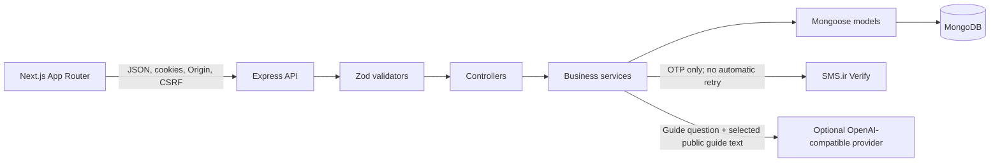

# Architecture

## System overview

Asoudeh is a browser-based Persian/RTL personal-finance application. The frontend is a Next.js App Router application; the backend is an Express API; MongoDB is accessed through Mongoose.

## Frontend

- `frontend/app/` contains the root document, public pages, authentication pages, and authenticated dashboard routes.
- `frontend/components/` contains the shared RTL shell, brand, loading, public-page, and assistant UI.
- `frontend/lib/api/client.ts` centralizes credentialed API calls, in-memory CSRF handling, session refresh/retry, and error handling.
- `frontend/lib/` also contains date, authentication-flow, and public-content utilities.
- Dashboard feature pages own their feature-specific loading, form, and presentation state. The API remains authoritative for authentication and financial data.
- Browser storage is limited to non-secret UI or draft state. The current OTP flow stores only the pending phone, step, and resend time in tab-scoped session storage; it never stores an OTP, access token, or refresh token.

## Backend request flow

The Express application in `backend/src/app.ts` applies Helmet, credentialed CORS, JSON parsing, request logging, feature routers, not-found handling, and centralized error handling. Feature code is organized as:

1. **Routes** select middleware and endpoints.
2. **Validators** parse request bodies/parameters with Zod.
3. **Controllers** translate HTTP requests into service calls and responses.
4. **Services** implement authentication, ownership, business rules, and aggregation.
5. **Models** define persisted MongoDB documents and indexes.

The API base path is `/api/v1`; the registered endpoint contract is in [API.md](./API.md).

## Authentication and authorization

Login requests an OTP, and verification either creates an authenticated session or starts registration. Session cookies are HTTP-only except for the CSRF cookie; the frontend holds the CSRF token in memory. State-changing cookie-authenticated requests require the configured Origin and a matching CSRF cookie/header. Authentication and session details are in [SECURITY.md](./SECURITY.md).

Services use the authenticated user ID for personal-data queries. Caregiver access is a separate, accepted, permission-scoped read path; it does not grant writes. See [DATABASE.md](./DATABASE.md) for ownership boundaries and [API.md](./API.md) for endpoint rules.

## External services and background work

- SMS.ir is used only by the backend Verify adapter when the development simulator is disabled. Provider acceptance is not evidence of handset delivery. The optional real Sandbox test is separately gated.
- The guide assistant is optional and disabled until all backend provider settings are valid. It sends a question and selected public guide content only; private account/financial records are not included.
- Account deletion is scheduled after OTP confirmation, revokes access immediately, and is purged by a backend worker that checks on startup and periodically. It is not a MongoDB TTL deletion.
- The service worker caches only a generic offline page and its icon; authenticated pages and API responses are excluded.

## Data and deployment boundaries

Amounts are represented as integer toman values at API/model boundaries where possible; aggregate totals that require exact arithmetic are returned as integer strings. Financial month boundaries and monthly reminder behavior use the Solar Hijri calendar with Tehran-local rules where specified.

Production deployment, database index rollout, backup/restore, live SMS delivery, and operational monitoring have not been verified. Do not treat this architecture document as a deployment runbook or production certification.
