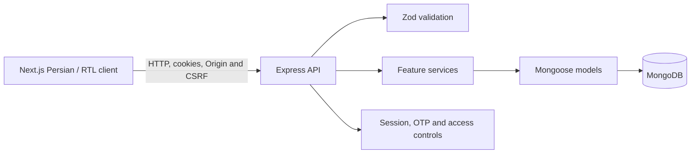

# Asoudeh — Project Engineering Report

## Executive summary

Asoudeh is a Persian, right-to-left personal finance application aimed at older adults and users who benefit from a simpler interface. The repository contains a Next.js frontend and an Express/MongoDB API. The principal product workflows are implemented: passwordless OTP authentication, profile and category management, transaction tracking with text search and sorting, dashboard totals, budgets, reminders, monthly reports, and permission-scoped read-only caregiver access. The shared shell includes optional browser text-to-speech, and a guide assistant UI/API that stays unavailable until a backend-only provider is configured.

The implementation is suitable for continued development and local verification, but **is not ready for production operation**. An SMS.ir Verify adapter exists, but the checked-in template has no API key and no approved template or live delivery has been verified. The real local `.env` was not inspected. Production deployment, database index rollout, accessibility certification, and real-user usability evaluation are also unverified.

This report records the current implementation and evidence without treating roadmap notes or specification goals as delivered or measured results.

## Project purpose and scope

The product is intended to help people manage personal income, expenses, monthly budgets, and reminders through an accessible Persian/RTL experience. A user may grant a caregiver specifically selected read-only permissions. The caregiver must accept an invitation addressed to their verified phone; permissions can be revoked and access events are audited.

The repository includes the original requirements in [SPECIFICATION.pdf](./SPECIFICATION.pdf), as well as implementation decisions and operational notes. The specification's UX targets—including completing common tasks in roughly 30 seconds, approximately 90% task success, and an accessibility score target around 95—are **goals, not measured outcomes**. No user study or WCAG/Lighthouse certification is claimed.

## Architecture and technology

| Layer | Implementation |
| --- | --- |
| Web client | Next.js App Router, React, TypeScript, Tailwind CSS; Persian and RTL |
| API | Node.js, Express, TypeScript, Zod request validation |
| Persistence | MongoDB through Mongoose models and indexes |
| Authentication | OTP/passwordless flow, cookie-backed sessions, CSRF token and Origin validation |
| Tests | Vitest and Supertest for backend, Node test runner for Jalali utilities, Playwright for browser flows |

The backend separates routes, controllers, services, models, and validators. Feature route/service/model files are located in [backend/src/routes](../backend/src/routes), [backend/src/services](../backend/src/services), and [backend/src/models](../backend/src/models). The frontend pages and components are under [frontend/app](../frontend/app), with API clients and shared utilities under `frontend/lib`.

The frontend uses the local logo variants in `frontend/public/logo/` through the reusable [BrandLogo component](../frontend/components/brand/BrandLogo.tsx). Full wordmarks preserve their viewBox proportions; symbol-only variants use a separate Persian label where needed. The PWA manifest uses distinct square PNG icons, including a separate maskable export; the offline shell caches only `/offline.html` and `/icons/app-icon.svg`. The supplied horizontal and primary SVGs contain font-dependent text and remain unchanged; see [brand integration](./BRAND_INTEGRATION.md).

The baseline review found asynchronous loading states implemented as isolated text messages and pages owning their data/state directly. The largest routes are transactions (about 1,134 lines), reminders (508), budgets (477), and settings (390). This task adds the reusable [PageSkeleton component](../frontend/components/ui/PageSkeleton.tsx) with per-screen layouts, an accessible status announcement, theme-aware shimmer, and reduced-motion support; it is used on dashboard, transactions, categories, budgets, reports, reminders, caregiver, and settings loading paths. Existing feature pages remain responsible for their API and domain state. A wholesale split of the large transaction/reminder pages is deliberately left as follow-up work to avoid a broad, riskier rewrite of stable financial flows.

Important feature areas include:

- **Authentication and profile:** [auth routes](../backend/src/routes/auth.routes.ts), [auth service](../backend/src/services/auth.service.ts), user and session models, OTP challenges, and account-deletion processing.
- **Financial core:** categories, transactions, dashboard, budgets, reminders, and reports each have their own API/service areas.
- **Caregiver access:** explicit invitation/acceptance, permission checks, revocation, and audit records; no caregiver write operations are provided.
- **Guide assistant:** optional, authenticated help based on public guide content only. It does not receive personal financial data or persist conversations in Asoudeh; provider retention is outside the application's control.
- **Dates and money:** Solar Hijri month handling is used for financial periods and reminder recurrence. Financial aggregates that require exact arithmetic are returned as integer strings.
- **Offline behavior:** the service worker caches only the generic public offline page and its icon. It does not cache authenticated pages or API responses.

See the [API contract](./API.md) for registered routes and response behavior. That document distinguishes live routes from planning notes.

## Implemented scope and gap inventory

Status meanings:

- **IMPLEMENTED** — the feature is present in the application/API and has relevant code or test coverage.
- **PARTIALLY IMPLEMENTED** — a meaningful subset is delivered, but an identified part or operational validation remains.
- **NOT IMPLEMENTED** — the feature is not present in the current product.
- **BLOCKED** — implementation or safe activation depends on a missing external capability, infrastructure decision, or product decision.
- **NOT VERIFIED** — no adequate evidence of actual production, accessibility, or user outcome verification is available.

| Area | Status | Current behavior and boundary |
| --- | --- | --- |
| Account creation and authentication | **PARTIALLY IMPLEMENTED** | Passwordless OTP registration/login, refresh-token rotation/reuse detection, logout, CSRF and Origin checks, profile editing, a dedicated OTP route, a backend-enforced resend cooldown, and ten-minute server-side idle expiry are implemented. Activity renewal uses an authenticated CSRF-protected endpoint. The development simulator is opt-in only. Real SMS is absent, so production OTP delivery is unavailable. |
| Development OTP simulator | **IMPLEMENTED** | When explicitly enabled in development, the configured fallback is entered manually. The API does not return the OTP, browser storage does not retain it, and there is no quick-login bypass. Challenges remain single-use, expire after five minutes, are stored as keyed digests, and retain rate/attempt limits. |
| Profile and accessibility preferences | **IMPLEMENTED** | Profile fields include display name, optional birth year and initial balance; font scaling and high-contrast preferences are persisted and applied in the client. |
| Shared visual system and application navigation | **PARTIALLY IMPLEMENTED** | Dashboard routes share a responsive RTL shell, eight linked destinations, a single reusable real SVG brand logo, CSS design tokens, persisted light/dark themes, visible focus styles, reduced-motion support, and reusable page-shaped loading skeletons. A font stack is provided without bundling an unverified font asset. Logo rendering, skeleton transitions, responsive behavior, and theme persistence have Playwright regression coverage; WCAG conformance, real screen-reader behavior, contrast measurements, and real-user usability remain unverified. |
| Browser text-to-speech | **PARTIALLY IMPLEMENTED** | A user-initiated control reads visible page text using a Persian voice from the browser/system Speech Synthesis API and provides an explicit stop control. Unsupported browsers or missing Persian voices produce a Persian status message. Browser tests use a stubbed voice; availability, pronunciation, privacy behavior, and assistive-technology interaction on real devices remain unverified. The speech engine may be implemented by the browser or operating system, so processing location depends on the user’s environment. |
| Account deletion | **PARTIALLY IMPLEMENTED** | A fresh OTP schedules permanent deletion 30 days later and immediately revokes access; a worker checks at startup and every 60 seconds. Purge is idempotent and retries after failures. There is currently no cancellation API, and production OTP delivery remains unavailable. See [account-deletion service](../backend/src/services/accountDeletion.service.ts). |
| Personal/system categories | **PARTIALLY IMPLEMENTED** | Listing, personal category creation/editing, and activation controls are available. A guarded, development-only command seeds system categories. Physical deletion and transaction reassignment are intentionally disabled; the route returns `409 CATEGORY_DELETION_UNAVAILABLE`. Safe activation needs a transaction-capable topology or equivalent workflow and a confirmed income fallback. |
| Transactions | **IMPLEMENTED** | Owner-scoped create/list/edit, type/category/date filters, literal text search across notes and owner/system category names, selectable date/amount sort order, 20-item default pagination, soft deletion, ten-second server-enforced undo, Jalali date entry, and an opt-in draft are present. Search input is length-limited and escaped before MongoDB regex use. Pagination and filters are server-side. The draft is account-keyed and session-only; it is not an offline queue or sync mechanism. |
| Dashboard | **IMPLEMENTED** | Displays current Solar Hijri month income/expense totals, remaining balance based on initial balance plus current-month income minus expenses, recent transactions, and eligible upcoming reminders. |
| Monthly budgets | **IMPLEMENTED** | Owner-scoped monthly expense budgets, category constraints, exact spending totals, and normal/warning/exceeded thresholds are implemented. |
| Reminders | **PARTIALLY IMPLEMENTED** | Reminder CRUD/archive, monthly Jalali recurrence, short-month date clamping, and month-scoped completion history are implemented. SMS, email, push, and other scheduled notification delivery are not implemented. |
| Monthly reports | **IMPLEMENTED** | Owner-scoped income/expense totals, category expense shares, and comparison to the previous Jalali month are provided through the API and UI. |
| Caregiver access | **PARTIALLY IMPLEMENTED** | Invitations, explicit acceptance/rejection, granular read-only permissions, audit events, and revocation are implemented. SMS invitation delivery is absent; invitation communication must happen out of band. Production index rollout has not been verified. |
| PWA and offline use | **PARTIALLY IMPLEMENTED** | Manifest, production service worker, public offline fallback, and guarded account-keyed session draft are implemented. Authenticated/API caching, offline submission, and automatic synchronization are intentionally absent. |
| Physical category deletion | **BLOCKED** | The route exists but is intentionally disabled to prevent unsafe multi-document reassignment on standalone MongoDB and because the income fallback is unresolved. |
| SMS.ir OTP integration | **PARTIALLY IMPLEMENTED** | A server-only Verify API adapter, explicit production mode, challenge locking, sanitized provider errors, and mocked provider/authentication tests are implemented. The current official OpenAPI does not document sandbox behavior. No account key, approved template ID, exact parameter name, or real SMS outcome has been verified; live sending remains blocked on account configuration and explicit authorization. |
| Password recovery | **NOT IMPLEMENTED** | The product uses passwordless phone/OTP authentication and has no password-reset flow. Phone/account recovery policy would need a separate product decision if required. |
| Reminder/invitation notifications | **NOT IMPLEMENTED** | The app shows reminders and records caregiver invitations, but does not deliver notifications externally. |
| Guide assistant | **PARTIALLY IMPLEMENTED** | Authenticated UI/API and an optional OpenAI-compatible provider are implemented. It uses selected public guide content only, is rate-limited, and does not persist conversations in Asoudeh. Provider configuration and retention behavior have not been verified. |
| OCR and voice input | **NOT IMPLEMENTED** | OCR and voice input are not present. Browser text-to-speech is a separate user-initiated feature; its actual system voice and assistive-technology behavior are unverified. |
| Production deployment and operations | **NOT VERIFIED** | No production deployment, operational smoke test, or production runbook verification is evidenced by this repository snapshot. |
| Database index rollout | **NOT VERIFIED** | Index definitions exist in the models, but their safe rollout against production data and topology has not been verified. |
| Accessibility/usability outcomes | **NOT VERIFIED** | UI settings and some accessibility-oriented behavior exist, but no WCAG conformance, Lighthouse score, assistive-technology audit, or real-user study has been completed. |

## Prioritized implementation and verification matrix

This matrix prioritizes the remaining work rather than proposing features for their own sake. Acceptance criteria are future gates unless the row is marked complete.

| Priority | Feature and user value | Existing implementation | Remaining work / security or data-integrity implications | Dependencies | Acceptance criteria and test coverage |
| --- | --- | --- | --- | --- | --- |
| **P0 — resolved** | Login-to-OTP navigation; users must reach a code entry screen after a request is accepted. | The browser now navigates to `/verify-otp`; a pending request is kept in tab-scoped session storage, not in the URL. | No authentication decision is made from stored client state; only the backend can verify a code and issue cookies. | None for the development simulator. | Browser tests cover accepted request/navigation, invalid request, API/network failure, direct route access without a pending request, refresh recovery, invalid code, registration, and existing-user sign-in. Backend tests cover session cookies and replay rejection. |
| **P1 — blocked externally** | Real SMS OTP delivery; necessary for production sign-in and account-deletion confirmation. | An SMS.ir Verify adapter is implemented; the development-only simulator is separately guarded by `NODE_ENV` and explicit opt-in. No live account values or template are configured. | Do not silently fall back to the fixed development code in production. Avoid logging codes, tokens, or phone identifiers; retain generic account responses and rate limits. | SMS.ir API key, approved Verify template ID and exact parameter name, account permissions/credit, and explicit authorization for a live test. Public OpenAPI does not document sandbox behavior. | Mocked provider and auth tests pass. A real test remains pending; do not claim delivery until the authorized request and handset/provider report are checked. |
| **P1 — blocked by design/infrastructure** | Safe category deletion and transaction reassignment; lets users clean up categories without losing transaction history. | The delete route explicitly returns `409 CATEGORY_DELETION_UNAVAILABLE`; category activation/deactivation remains available. | Reassignment on standalone MongoDB can race with concurrent transaction creation and produce inconsistent references. The income fallback is unresolved. | Transaction-capable MongoDB or a proven equivalent workflow, plus a confirmed income fallback. | Define type-correct fallbacks; prove concurrent reassignment/create cannot leave invalid references; test rollback/failure and owner isolation before enabling deletion. |
| **P1 — operational gate** | Reliable account lifecycle and privacy; deletion has a 30-day grace period and immediately revokes access. | OTP-confirmed scheduling, session/caregiver access revocation, periodic worker, idempotent cleanup, and retry after failure are implemented. | Safe index rollout, operational worker failure visibility, backup/retention policy, and production verification remain. The current specification does not require cancellation, so no cancellation endpoint is added without a product requirement. | Production-like MongoDB topology, index migration procedure, and operations/retention policy. | On isolated test data, verify 30-day eligibility, immediate denial, caregiver denial, retries, and idempotent cleanup; in deployment, verify indexes and worker health without destructive production tests. |
| **P1 — operational gate** | Production deployment and data integrity; protects persisted finances and account records. | Readiness endpoint, owner-scoped APIs, model indexes, and safe development/test database guards exist. | No production deployment or index rollout is verified. Index build against existing records may fail or affect availability. | Hosting environment, same-site HTTPS origins, reviewed database and backup policy, operator-approved migrations. | Deploy to a non-production environment; verify health/readiness, index uniqueness, backups/restore, safe secrets, and smoke tests before production traffic. |
| **P2 — quality gate** | Accessibility and usability for the intended older-adult audience. | Persian/RTL UI, font scaling, high contrast, and keyboard-focus styling exist. | No conformance or real-user outcome is measured; do not claim WCAG or specification UX targets without evidence. | Representative users, assistive technology, and an agreed accessibility target. | Complete keyboard, screen-reader, zoom, contrast, touch-target, and representative user testing; record measured task completion/time and audit results. |
| **P2 — optional product decision** | External reminder/invitation notifications; can help users act on scheduled items and caregiver invitations. | In-app reminders and caregiver invitation records exist. | Delivery channels, consent, privacy, retry policy, and user controls are undefined; avoid sending sensitive financial details in notifications. | Product approval and a delivery provider if required. | Define minimal notification content and opt-in/opt-out rules; test delivery failures, duplicate suppression, and access revocation before any launch. |
| **P2 — optional product decision** | Improve the guide assistant only if users need help beyond the current static guide. | Optional authenticated UI/API exists; provider configuration is off by default. | Keep account/financial data excluded; assess external provider retention, privacy, and quality. | Product approval, provider review, and explicit privacy requirements. | Test bounded public-guide questions, unavailable/error behavior, and provider retention before enabling. |
| **P3 — out of current scope** | OCR or voice input could reduce data entry. | Not implemented. | Adds privacy, accuracy, accessibility, and operational risks; no implementation is justified until user research establishes value. | Product scope, privacy assessment, and appropriate validation strategy. | Approve a narrow use case and measurable acceptance criteria before implementation. |

## Security, privacy, and data-handling notes

The current code and API contract document the following controls:

- Protected actions derive ownership from the authenticated identity and scope queries to that owner.
- Cookie-authenticated state changes require the configured Origin and a matching CSRF cookie/header pair. Access and refresh credentials are not intended for browser local storage.
- Request bodies are validated with Zod. Public errors use a generic response shape rather than exposing internal exception details.
- Unexpected backend exceptions are returned as a generic localized response and logged as structured metadata without raw error messages; development logs may include stack frames with the first line omitted.
- OTP requests are throttled by phone and IP; failed verification attempts are limited and can temporarily block the phone. OTP challenges and rate-limit keys use keyed digests rather than storing the OTP or raw throttle keys.
- Caregiver access is read-only, permission-checked, explicitly accepted, revocable, and audited. A revoked or invalid link must not reveal the protected user's data.
- Account deletion immediately revokes access and schedules account-related data purging. The worker is retryable and idempotent, but it is not a multi-collection MongoDB transaction.
- The PWA does not cache authenticated pages, account data, or API responses.

These observations describe implemented design controls; they are **not** a substitute for an independent security audit or production security assessment. Before launch, review secret provisioning, deployment origins/cookie settings, database access controls, rate-limit behavior under multiple instances, index migration, logging, backups, and purge obligations in the actual hosting environment.

## Dependency audit

Audit was rerun against the checked-in lockfiles and installed dependency trees on 2026-10-22:

| Scope | Result | Action and remaining limitation |
| --- | --- | --- |
| Backend production and development dependencies | **0 vulnerabilities** | The test toolchain was upgraded to Vitest 4.1.12 and Vite 7.3.7. Backend tests, lint, typecheck, and build passed after the upgrade. |
| Frontend production dependencies (`npm audit --omit=dev`) | **0 vulnerabilities** | Next.js remains on 15.5.28; its nested PostCSS dependency is overridden to the compatible patched PostCSS 8.5.31. Frontend production build and browser regression checks are required after the change. |
| Frontend full dependency tree | **9 development-only advisories: 7 high, 2 moderate** | Findings are in the Tailwind 3.4.19 / `eslint-config-next` toolchain dependency paths. npm only offers major-version remedies (Tailwind 4 and/or Next ESLint config changes) in the current lock resolution. These were not upgraded blindly; CI/developer tooling remains a dependency risk and requires a separately tested migration. |

## Verification evidence

The following checks were run against the local development/test setup after the current changes. They are not claims about production runtime behavior.

| Check | Result |
| --- | --- |
| Backend API/unit suite (Vitest 4.1.12) | **113 passed** using the isolated local `asoudeh_test` database; includes idle-session expiry/activity, refresh reuse, OTP, transactions, literal search/sort, and error-response regression checks. |
| TypeScript typechecks | Backend and frontend typechecks passed after the prior feature work; frontend typecheck also passed after the logo, skeleton, and duplicate-submit changes. |
| Lint | Backend and frontend lint passed after the prior feature work; frontend lint passed again after the current UI/auth changes. |
| Backend production build | Passed after backend dependency and error-handler changes. |
| Frontend production build | Passed after the logo, skeleton, and duplicate-submit changes; `/transactions` remains a generated static route. |
| Jalali date tests | **3 passed.** |
| Playwright development suite (Edge, 1 worker) | **30 passed, 1 skipped.** This includes auth, financial workflows, the shared logo, skeleton transitions, the responsive shell/theme, and mocked Persian speech behavior. The production-only PWA test is intentionally skipped in development mode. |
| Focused logo/skeleton/OTP E2E (Edge, 1 worker) | **Historical: 5 passed.** SVG loading in login/OTP, pending and completed budget loading, manual OTP entry, registration routing, and duplicate-submit protection were checked. |
| Playwright production PWA check (Edge) | Previously recorded as **1 passed, 1 skipped**; this does not establish production deployment readiness. |
| Live frontend/backend OTP smoke test (Edge) | Passed against the actual local frontend and API: OTP request, `/verify-otp`, verification, registration, authenticated settings/profile fetch, and HttpOnly access/refresh cookies. It used a unique local temporary database, which was removed afterward. |

The Playwright suite uses intercepted API responses for application workflows; speech tests stub the browser voice API and do not validate a real Persian voice. The separate earlier live smoke test exercised frontend/backend registration on an isolated database. SMS.ir tests mock all HTTP requests. **Real SMS delivery was not tested; the sample API key is blank, an approved template is unverified, and the local `.env` was not inspected.** Full WCAG 2.2 AA, screen-reader, 200% zoom, real-voice pronunciation, and representative-user checks remain unverified.

The current UI/auth validation commands were `npm run typecheck:frontend`, `npm run lint:frontend`, `npm --prefix frontend run test:jalali`, `npm run build:frontend`, and the frontend-local Playwright CLI with `--workers=1`. The full serial Playwright suite completed with 30 passed and one production-only skip after a parallel cold-development run timed out under server load.

The database test uses a dedicated local URI and refuses unsupported remote or credential-bearing targets. The regular backend suite skips the database integration test when its dedicated test URI is absent. Refer to [environment setup](./ENVIRONMENT.md) before running it.

Relevant test locations include [backend tests](../backend/src/tests), [frontend browser tests](../frontend/tests), and the [Jalali date test](../frontend/tests/jalaliDate.test.mjs).

## Repository and change history

At the start of the current OTP review, `main` and `origin/main` both pointed to `b67d78c` (`feat: complete local development and project docs`). The verified remote is `https://github.com/MohamadRezaChaghomi/asoudeh.git`. The committed history includes the authentication/backend foundation, transaction and dashboard work, budgets, reminders, caregiver/report/PWA/account-deletion milestones, local OTP simulator, readiness checks, pagination fix, and project documentation.

At the time of the OTP-flow review, the following changes were pending:

- Root cause correction and separate verification page: `frontend/app/(auth)/login/page.tsx`, `frontend/app/(auth)/verify-otp/page.tsx`, and `frontend/lib/auth/otpFlow.ts`.
- OTP regression tests: `frontend/tests/auth.spec.ts`.
- Resend cooldown configuration and atomic server enforcement: `backend/.env.example`, `backend/src/config/env.ts`, `backend/src/controllers/auth.controller.ts`, `backend/src/models/OtpChallenge.ts`, `backend/src/services/auth.service.ts`, and `backend/src/tests/auth.api.test.ts`.
- Current documentation updates: [README](../README.md), [API](./API.md), [decisions](./DECISIONS.md), [environment](./ENVIRONMENT.md), this report, and [handover](./PROJECT_HANDOVER.md).

The pending OTP/session changes, transaction search, speech control, dependency updates, tests, and documentation were subsequently committed together as `f2618c1` (`feat: harden sessions and expand accessibility`). The commit was not pushed.

The current logo, skeleton, and OTP duplicate-submit guard changes remain local and uncommitted, as requested. No dependency manifest or backend file was changed in this UI task.

## Recommended next steps

1. **Before any production login:** enter the SMS.ir account values into the ignored backend environment, confirm template approval/parameter mapping and credit, explicitly select production, and verify a user-authorized test; keep the development simulator unavailable in non-development environments.
2. **Before production traffic:** review MongoDB topology, credentials, backups, and access controls; safely deploy and verify the required indexes against real data; verify the deletion worker and retention behavior operationally.
3. **Resolve category deletion:** choose a valid fallback for both expense and income categories and implement reassignment with concurrency safety; otherwise keep the existing explicit `409` behavior.
4. **Account-deletion cancellation:** the reviewed specification does not require a cancellation route. Keep the current behavior unless the product explicitly adopts a cancellation requirement, then define identity verification and session behavior before implementation.
5. **Complete accessibility validation:** run keyboard, screen-reader, contrast, zoom, and mobile touch checks, then measure the specified Lighthouse/accessibility goals. Do not report a score or conformance level before measurement.
6. **Run usability studies:** evaluate core tasks with representative older adults and less-experienced users, measure task completion and time, and prioritize observed blockers.
7. **Add operational readiness:** choose deployment targets, configure environment secrets and same-site HTTPS origins, add CI checks, and execute production-like readiness and recovery drills.
8. **Reassess optional scope:** improve the existing guide assistant only if user research supports it and provider privacy terms are approved; defer notifications, OCR, and voice input until their requirements are defined.

## Source documents

- [README](../README.md)
- [API contract](./API.md)
- [Architecture](./ARCHITECTURE.md)
- [Database model and ownership notes](./DATABASE.md)
- [Security model](./SECURITY.md)
- [Test guide](./TESTING.md)
- [Current project status](./PROJECT_STATUS.md)
- [Environment setup](./ENVIRONMENT.md)
- [Development guide](./DEVELOPMENT.md)
- [Implementation decisions](./DECISIONS.md)
- [Roadmap](./ROADMAP.md)
- [Project handover](./PROJECT_HANDOVER.md)
- [Original product specification](./SPECIFICATION.pdf)

## Latest independent audit (2026-10-22)

The current checkout was rechecked against the original functional requirements, existing API/tests and runtime behavior. The review found and fixed three defects: a rounded budget percentage could incorrectly select `exceeded` while a positive balance remained; budget requests were missing the shared expired-session refresh retry; and the page-reader control had no visible content on mobile. Regression coverage now includes the exact 24,990/25,000 budget boundary, budget retry after a 401, and the mobile speech icon.

Final validation for that audit: backend Vitest **113 passed across 16 files** on the dedicated local test database; Jalali tests **3 passed**; serial Edge development E2E **31 passed, 1 production-only skip**; the separate production PWA test **1 passed, 1 dev-only skip**; backend/frontend typecheck, lint, and production builds passed. Production dependency audits reported zero for backend and frontend. The full frontend audit still reports **9 development-only advisories (7 high, 2 moderate)**; a breaking Tailwind 4 migration was not applied without a compatibility plan. See [requirement-level evidence](./REQUIREMENTS_TRACEABILITY.md) and the [full audit report](./QUALITY_AUDIT_REPORT.md) for exact scope, failures/retries, and residual limitations.

## Follow-up audit (2026-11-02)

This section supersedes the older test counts and dependency-audit snapshot above. Current local checks: backend **116 passed, 1 skipped** (the explicitly gated SMS Sandbox test); frontend Edge production E2E **37 passed, 1 skipped**; Jalali tests **4 passed**; backend/frontend lint, typecheck, and production builds passed. SMS provider unit and auth tests use mocked HTTP. No real SMS or Sandbox request was made.

The dependency audit found three production-tree High advisories and they were remediated: backend `body-parser`, backend Zod (upgraded to v4 with validator type compatibility updated), and frontend `follow-redirects`. A fresh production-only audit now reports **0 vulnerabilities** for both applications. Full development dependency audits retain **11 moderate backend** and **14 moderate frontend** findings in the lint/type-tooling dependency trees; automatic remediation would require breaking or unsuitable major changes, so no force upgrade was applied.

Static source review did not establish a confirmed exploitable application vulnerability. Production `NODE_ENV`/cookie security configuration and `JWT_SECRET` entropy remain operational requirements that cannot be confirmed without inspecting deployment configuration; no real `.env` was read. The current status, model details, security notes, and test evidence are maintained in [PROJECT_STATUS.md](./PROJECT_STATUS.md), [DATABASE.md](./DATABASE.md), [SECURITY.md](./SECURITY.md), and [TESTING.md](./TESTING.md).
