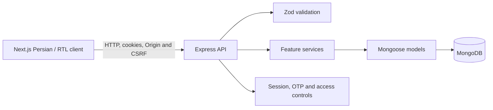

# Asoudeh — Project Engineering Report

## Executive summary

Asoudeh is a Persian, right-to-left personal finance application aimed at older adults and users who benefit from a simpler interface. The repository contains a Next.js frontend and an Express/MongoDB API. The principal product workflows are implemented: passwordless OTP authentication, profile and category management, transaction tracking, dashboard totals, budgets, reminders, monthly reports, and permission-scoped read-only caregiver access.

The implementation is suitable for continued development and local verification, but **is not ready for production operation**. Most importantly, no SMS provider is connected, so real OTP delivery and production login are unavailable. Production deployment, database index rollout, accessibility certification, and real-user usability evaluation are also unverified.

This report records the current implementation and evidence without treating roadmap notes or specification goals as delivered or measured results.

## Project purpose and scope

The product is intended to help people manage personal income, expenses, monthly budgets, and reminders through an accessible Persian/RTL experience. A user may grant a caregiver specifically selected read-only permissions. The caregiver must accept an invitation addressed to their verified phone; permissions can be revoked and access events are audited.

The repository includes the original requirements in [SPECIFICATION.pdf](./SPECIFICATION.pdf), as well as implementation decisions and operational notes. The specification's UX targets—including completing common tasks in roughly 30 seconds, approximately 90% task success, and an accessibility score target around 95—are **goals, not measured outcomes**. No user study or WCAG/Lighthouse certification is claimed.

## Architecture and technology

| Layer | Implementation |
| --- | --- |
| Web client | Next.js App Router, React, TypeScript, Tailwind CSS; Persian and RTL |
| API | Node.js, Express, TypeScript, Zod request validation |
| Persistence | MongoDB through Mongoose models and indexes |
| Authentication | OTP/passwordless flow, cookie-backed sessions, CSRF token and Origin validation |
| Tests | Vitest and Supertest for backend, Node test runner for Jalali utilities, Playwright for browser flows |

The backend separates routes, controllers, services, models, and validators. Feature route/service/model files are located in [backend/src/routes](../backend/src/routes), [backend/src/services](../backend/src/services), and [backend/src/models](../backend/src/models). The frontend pages and components are under [frontend/app](../frontend/app), with API clients and shared utilities under `frontend/lib`.

Important feature areas include:

- **Authentication and profile:** [auth routes](../backend/src/routes/auth.routes.ts), [auth service](../backend/src/services/auth.service.ts), user and session models, OTP challenges, and account-deletion processing.
- **Financial core:** categories, transactions, dashboard, budgets, reminders, and reports each have their own API/service areas.
- **Caregiver access:** explicit invitation/acceptance, permission checks, revocation, and audit records; no caregiver write operations are provided.
- **Dates and money:** Solar Hijri month handling is used for financial periods and reminder recurrence. Financial aggregates that require exact arithmetic are returned as integer strings.
- **Offline behavior:** the service worker caches only the generic public offline page and its icon. It does not cache authenticated pages or API responses.

See the [API contract](./API.md) for registered routes and response behavior. That document distinguishes live routes from planning notes.

## Implemented scope and gap inventory

Status meanings:

- **IMPLEMENTED** — the feature is present in the application/API and has relevant code or test coverage.
- **PARTIALLY IMPLEMENTED** — a meaningful subset is delivered, but an identified part or operational validation remains.
- **NOT IMPLEMENTED** — the feature is not present in the current product.
- **BLOCKED** — implementation or safe activation depends on a missing external capability, infrastructure decision, or product decision.
- **NOT VERIFIED** — no adequate evidence of actual production, accessibility, or user outcome verification is available.

| Area | Status | Current behavior and boundary |
| --- | --- | --- |
| Account creation and authentication | **PARTIALLY IMPLEMENTED** | Passwordless OTP registration/login, session rotation/revocation, logout, CSRF and Origin checks, and profile editing are implemented. The development simulator is opt-in only. Real SMS is absent, so production OTP delivery is unavailable. |
| Development OTP simulator | **IMPLEMENTED** | When explicitly enabled in development, the default local code is `123456` (configurable). The challenge is single-use, expires after five minutes, is stored as a keyed digest, and remains subject to rate and attempt limits. It is not a fallback for a failing production provider. |
| Profile and accessibility preferences | **IMPLEMENTED** | Profile fields include display name, optional birth year and initial balance; font scaling and high-contrast preferences are persisted and applied in the client. |
| Account deletion | **PARTIALLY IMPLEMENTED** | A fresh OTP schedules permanent deletion 30 days later and immediately revokes access; a worker checks at startup and every 60 seconds. Purge is idempotent and retries after failures. There is currently no cancellation API, and production OTP delivery remains unavailable. See [account-deletion service](../backend/src/services/accountDeletion.service.ts). |
| Personal/system categories | **PARTIALLY IMPLEMENTED** | Listing, personal category creation/editing, and activation controls are available. A guarded, development-only command seeds system categories. Physical deletion and transaction reassignment are intentionally disabled; the route returns `409 CATEGORY_DELETION_UNAVAILABLE`. Safe activation needs a transaction-capable topology or equivalent workflow and a confirmed income fallback. |
| Transactions | **IMPLEMENTED** | Owner-scoped create/list/edit, filtering, 20-item default pagination, soft deletion, ten-second server-enforced undo, Jalali date entry, and an opt-in draft are present. The pagination change now reloads the selected page. The draft is account-keyed and session-only; it is not an offline queue or sync mechanism. |
| Dashboard | **IMPLEMENTED** | Displays current Solar Hijri month income/expense totals, remaining balance based on initial balance plus current-month income minus expenses, recent transactions, and eligible upcoming reminders. |
| Monthly budgets | **IMPLEMENTED** | Owner-scoped monthly expense budgets, category constraints, exact spending totals, and normal/warning/exceeded thresholds are implemented. |
| Reminders | **PARTIALLY IMPLEMENTED** | Reminder CRUD/archive, monthly Jalali recurrence, short-month date clamping, and month-scoped completion history are implemented. SMS, email, push, and other scheduled notification delivery are not implemented. |
| Monthly reports | **IMPLEMENTED** | Owner-scoped income/expense totals, category expense shares, and comparison to the previous Jalali month are provided through the API and UI. |
| Caregiver access | **PARTIALLY IMPLEMENTED** | Invitations, explicit acceptance/rejection, granular read-only permissions, audit events, and revocation are implemented. SMS invitation delivery is absent; invitation communication must happen out of band. Production index rollout has not been verified. |
| PWA and offline use | **PARTIALLY IMPLEMENTED** | Manifest, production service worker, public offline fallback, and guarded account-keyed session draft are implemented. Authenticated/API caching, offline submission, and automatic synchronization are intentionally absent. |
| Physical category deletion | **BLOCKED** | The route exists but is intentionally disabled to prevent unsafe multi-document reassignment on standalone MongoDB and because the income fallback is unresolved. |
| Production SMS/OTP | **BLOCKED** | There is no provider integration or configured production delivery capability. The local simulator must not be enabled in production. |
| Password recovery | **NOT IMPLEMENTED** | The product uses passwordless phone/OTP authentication and has no password-reset flow. Phone/account recovery policy would need a separate product decision if required. |
| Reminder/invitation notifications | **NOT IMPLEMENTED** | The app shows reminders and records caregiver invitations, but does not deliver notifications externally. |
| OCR, voice input, chatbot | **NOT IMPLEMENTED** | These ideas are outside the implemented release scope. |
| Production deployment and operations | **NOT VERIFIED** | No production deployment, operational smoke test, or production runbook verification is evidenced by this repository snapshot. |
| Database index rollout | **NOT VERIFIED** | Index definitions exist in the models, but their safe rollout against production data and topology has not been verified. |
| Accessibility/usability outcomes | **NOT VERIFIED** | UI settings and some accessibility-oriented behavior exist, but no WCAG conformance, Lighthouse score, assistive-technology audit, or real-user study has been completed. |

## Security, privacy, and data-handling notes

The current code and API contract document the following controls:

- Protected actions derive ownership from the authenticated identity and scope queries to that owner.
- Cookie-authenticated state changes require the configured Origin and a matching CSRF cookie/header pair. Access and refresh credentials are not intended for browser local storage.
- Request bodies are validated with Zod. Public errors use a generic response shape rather than exposing internal exception details.
- OTP requests are throttled by phone and IP; failed verification attempts are limited and can temporarily block the phone. OTP challenges and rate-limit keys use keyed digests rather than storing the OTP or raw throttle keys.
- Caregiver access is read-only, permission-checked, explicitly accepted, revocable, and audited. A revoked or invalid link must not reveal the protected user's data.
- Account deletion immediately revokes access and schedules account-related data purging. The worker is retryable and idempotent, but it is not a multi-collection MongoDB transaction.
- The PWA does not cache authenticated pages, account data, or API responses.

These observations describe implemented design controls; they are **not** a substitute for an independent security audit or production security assessment. Before launch, review secret provisioning, deployment origins/cookie settings, database access controls, rate-limit behavior under multiple instances, index migration, logging, backups, and purge obligations in the actual hosting environment.

## Verification evidence

The following checks were recorded during the current review, against the local development/test setup. They are not claims about production runtime behavior.

| Check | Result |
| --- | --- |
| Backend API/unit suite | **94 passed** using the isolated local `asoudeh_test` database. |
| TypeScript typechecks | Backend and frontend typechecks passed. |
| Lint | Backend and frontend lint passed. |
| Backend production build | Passed. |
| Frontend production build | Passed. |
| Jalali date tests | **3 passed.** |
| Playwright development suite (Edge) | **15 passed, 1 skipped.** |
| Playwright production PWA check (Edge) | **1 passed, 1 skipped.** The skip is for the alternate execution mode, not a successful production deployment check. |

The database test uses a dedicated local URI and refuses unsupported remote or credential-bearing targets. The regular backend suite skips the database integration test when its dedicated test URI is absent. Refer to [environment setup](./ENVIRONMENT.md) before running it.

Relevant test locations include [backend tests](../backend/src/tests), [frontend browser tests](../frontend/tests), and the [Jalali date test](../frontend/tests/jalaliDate.test.mjs).

## Repository and change history

At the time of this report, `main` and `origin/main` both point to `58eb74a` (`docs: record requested local server shutdown`). The verified remote is `https://github.com/MohamadRezaChaghomi/asoudeh.git`. The committed history includes the authentication/backend foundation, transaction and dashboard work, budgets, reminders, and caregiver/report/PWA/account-deletion milestones.

The following worktree changes were **not committed or pushed** at the time this report was prepared:

- OTP development simulator and safeguards: `backend/.env.example`, `backend/src/config/env.ts`, `backend/src/models/OtpChallenge.ts`, `backend/src/services/auth.service.ts`, and `backend/src/tests/auth.api.test.ts`.
- Database readiness: `backend/src/config/db.ts`, `backend/src/controllers/health.controller.ts`, `backend/src/routes/health.routes.ts`, and `backend/src/tests/health.test.ts`.
- Transaction pagination fix and E2E regression test: `frontend/app/(dashboard)/transactions/page.tsx` and `frontend/tests/transactions.spec.ts`.
- Related documentation updates: [API](./API.md), [decisions](./DECISIONS.md), [environment](./ENVIRONMENT.md), [handover](./PROJECT_HANDOVER.md), and [roadmap](./ROADMAP.md).
- This report and the rewritten root README.

The README and report do not imply that any of these pending changes are already part of `main`. No commit or push was made for this documentation task.

## Recommended next steps

1. **Before any production login:** choose and integrate an SMS provider; keep the development simulator unavailable in non-development environments and test delivery failure, throttling, and non-disclosure behavior.
2. **Before production traffic:** review MongoDB topology, credentials, backups, and access controls; safely deploy and verify the required indexes against real data; verify the deletion worker and retention behavior operationally.
3. **Resolve category deletion:** choose a valid fallback for both expense and income categories and implement reassignment with concurrency safety; otherwise keep the existing explicit `409` behavior.
4. **Decide account-deletion cancellation policy:** the current 30-day delay has no cancellation route. If cancellation is required, define identity verification and session behavior before implementation.
5. **Complete accessibility validation:** run keyboard, screen-reader, contrast, zoom, and mobile touch checks, then measure the specified Lighthouse/accessibility goals. Do not report a score or conformance level before measurement.
6. **Run usability studies:** evaluate core tasks with representative older adults and less-experienced users, measure task completion and time, and prioritize observed blockers.
7. **Add operational readiness:** choose deployment targets, configure environment secrets and same-site HTTPS origins, add CI checks, and execute production-like readiness and recovery drills.
8. **Reassess optional scope:** only prioritize notifications, OCR, voice, or chatbot features after product and privacy requirements are defined.

## Source documents

- [README](../README.md)
- [API contract](./API.md)
- [Environment setup](./ENVIRONMENT.md)
- [Development guide](./DEVELOPMENT.md)
- [Implementation decisions](./DECISIONS.md)
- [Roadmap](./ROADMAP.md)
- [Project handover](./PROJECT_HANDOVER.md)
- [Original product specification](./SPECIFICATION.pdf)
